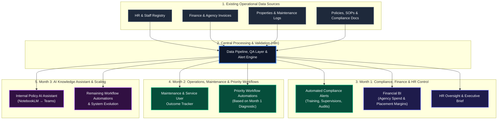
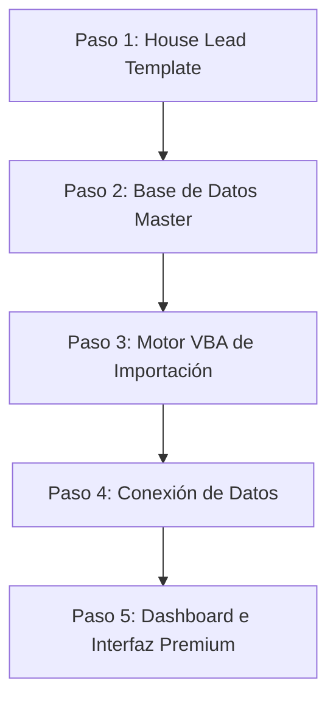

# Pearl Connexions · historial de conversaciones

Registro cronológico de mails, reuniones y decisiones con Joel Samuel y su equipo, **del más reciente al más antiguo**. Sirve para consultar qué se dijo y cuándo. No es fuente de verdad: si algo de acá contradice [ESTADO-ACTUAL.md](../2-actual/ESTADO-ACTUAL.md), vale ESTADO-ACTUAL.

**Cómo usarlo:** por defecto se consultan las entradas de los últimos dos meses. Lo anterior (mayo a agosto) se lee solo si se pregunta específicamente o para entender por qué algo es como es.

Marcas: **[Decisión]** acuerdo que cambió el rumbo · **[Reemplazado]** idea o acuerdo que después cambió · **[Pedido]** requerimiento de Joel.

Fuentes: Gmail de enzothome1 (hilos «quality assurance dashboard», «Web tools», «Meeting», «Leadership Workbooks – Recurring Tasks…»), notas de reunión de Gemini y Teams, archivos de esta carpeta e historial de commits. Lo hablado en Teams, WhatsApp o en reuniones sin notas no queda registrado salvo que se agregue a mano.

---

## Noviembre 2026

- **27/11 (próxima).** Reunión con Joel y Renee: primero la web, después el QA Dashboard.
- **26/11.** Commit en el dashboard con las tareas recurrentes mensuales, los adjuntos, el envío de gastos al neighbourhood controller y los badges CQC/Ofsted.
- **25/11.** Joel le reenvía a Renee la invitación del viernes: «this Friday we will review the website and go through the QA dashboard».
- **24/11.** Enzo confirma que para el viernes tendrá los cambios de los mails del 23/11 y de la semana anterior, más los puntos de la última reunión. Joel responde «Sounds great» (25/11).
- **23/11. [Pedido]** Joel pide **tareas recurrentes mensuales** en los Leadership Workbooks:
  - Cada mes tiene su propio deadline (ejemplo: el 25).
  - Una tarea no está completa hasta que el dueño del workbook la firma (sign-off). Si no está firmada al deadline pasa a Overdue, aunque se haya marcado como hecha.
  - Se guarda el historial de meses anteriores.
  - Se distinguen las acciones únicas de las recurrentes.
  - Todo alimenta el QA Dashboard.
  - Ejemplos: Zulaikha revisa care plans y risk assessments; Simmone hace los controles de HR y el rota.
- **20/11.** Reunión (pasó a las 11:30). Joel manda muestras de finanzas: Business Expenses y Staff Pay Summary de agosto, más una factura ([carpeta](../3-documentos-pearl/finanzas/2026-11-20-muestras-joel/)). También le pide a Renee que revise la web antes del viernes siguiente: «We will review the QA dashboard after we've sorted the website».
- **19/11.** La web se alinea con las actualizaciones de Figma.
- **16/11. [Decisión]** Las casas pasan a nombres de gemas y se agrega el barrio. Header transparente sobre el hero y logo nuevo transparente.
- **14/11.** Nuevas páginas en la web: casas, FAQs, feedback y careers. About, Who we are y Contact se ajustan a Figma. Enzo pide no tocar los mapas reales ni las animaciones que agregó directamente en código.
- **13/11.** Joel manda handbooks de las casas (Sapphire, Onyx, Ruby, Garnet), fotos por casa, dos PDF de ideas para la web ([ideas](2026-11-ideas-web-joel/)) y la lista de usuarios por casa. No llegó por mail, así que el canal no está registrado. Reunión agendada para ese viernes.
- **06/11.** Reunión (12:00 Londres, con confusión de horario y de link). Después Enzo manda:
  - La «Welcome Sheet» con el link al portal de clientes (avances, reuniones y facturas).
  - El estado del dashboard: QA ampliado, incidentes y riesgos, HR, mantenimiento y finanzas. Les pide a los managers que lo prueben con sus propias cuentas.
  - La meta de terminar la web la semana siguiente, si consigue fotos públicas de casas y equipo.
  - Los permisos por sección en `/config/permissions`.
- **06/11.** [Final Summary Web](../2-actual/web/Final%20Summary%20Web.md): base editorial de la web.
- **04/11. [Decisión]** Definiciones de mantenimiento: Urgent significa peligro inmediato para la vida; objetivos de mismo día, 3, 7 y 30 días; registro de controles gas/EICR/PAT. Están en [Final Summary QA](../2-actual/dashboard/Final%20Summary%20QA.md).
- **03/11.** Enzo responde que los problemas de los managers están resueltos: todo quedó centralizado en **un único portal** con secciones según permisos. Calcula que la web y el dashboard están al 80%.
- **02/11. [Pedido]** Joel manda las dos Commissioner Placement Guides para la web ([guías](../3-documentos-pearl/guias-comisionados/)). Avisa que **ningún manager puede agregar ni firmar tareas** y pide arreglarlo con prioridad.

## Octubre 2026

- **23/10.** Enzo le recuerda a Joel la reunión de las 11. No hay respuesta registrada.
- **14/10. [Decisión]** Joel quiere ser el único que borra acciones y decidir qué puede hacer cada manager. Enzo agrega **permisos granulares** en Settings: agregar, editar, reasignar, firmar, borrar y gestionar empleados y logins.
- **13/10. [Reemplazado]** Los managers veían los workbooks en solo lectura. Enzo les da edición completa a todos, y al día siguiente se reemplaza por los permisos granulares.
- **13/10.** Enzo sube los cambios del workbook (falta vincular el calendario con Microsoft) y pide los PDF para la web.
- **09/10.** Reunión del viernes a las 11 por Teams. Enzo manda el link de cobro y Joel **paga la primera factura (200)** en octubre, casi dos meses después de aceptar.
- **06/10. [Pedido]** Joel dice que el workbook funciona «very smooth» con su equipo. Pide:
  - Referencia automática. Hoy, si se repite una referencia se borra la acción.
  - Cambiar los títulos de los workstreams.
  - Dar acceso de workbooks a los managers.
  - Ver acciones por semana y por mes.

  Promete pagar la factura pendiente ese jueves. De la encuesta de KPI solo respondió Ruben.

## Septiembre 2026

- **28/09.** Enzo manda novedades de la web y del QA, con las primeras ideas de HR y Finanzas, y consulta por el pago de la primera factura, que Joel había prometido para la semana anterior.
- **26/09.** Rediseño de la web. El dashboard suma los módulos de HR y Finanzas.
- **25/09.** Reunión fallida: Enzo no la había agendado.
- **17/09.** Reunión por Teams («dashboard website qa»). Joel define los **dueños de cada workbook**: Simmone (HR), Mike Wright (Children's Home), Zulaikha Halim (Supported Living), Ruben Purmah (Finanzas), Renee Minott (Business development, Supported Living) y Richard Ayodele (Supported Accommodation). Enzo manda el Google Form de KPI para los managers y el acceso al workbook con admin@.
- **16/09. [Decisión]** Joel manda el **logo y el manifiesto nuevos** ([marca](../1-marca/)) y pide usar la misma marca en la web, el QA Dashboard y los Leadership Workbooks. Agrega capturas de Canva. Pide una pestaña por provisión (Supported Living con registro y perfil de CQC; Supported Accommodation; Children's Home), con los marcos de Ofsted a explicar. Relevamiento en [cambios_requeridos_joel.md](#cambios-requeridos-joel).
- **15/09.** Joel comparte la página de Canva de Supported Living y pregunta cómo mejorar su web. Enzo abre un hilo nuevo («Web tools») con un prototipo de la web y la **primera factura del partnership (200)**. **Desde acá el proyecto pasa de Excel a web** (repositorio y deploy en Vercel), y a partir de este cambio el trabajo se acelera mucho: en dos semanas ya hay web, workbook web y módulos de HR y Finanzas.
- **04/09.** Reunión para revisar cada workbook y armar los canales de Teams.

## Agosto 2026

- **26/08. [Decisión] [Reemplazado]** Joel aprueba el flujo del workbook (Action Register, Dashboard de solo lectura, Monthly Review, Completed Actions). Pide poder poner el nombre de uno o de ambos en el sign-off, en lugar de las iniciales automáticas «MW / JS». Hay que replicarlo en todos los workbooks antes de pasar a las KPI de auditoría.
- **18/08.** Enzo arma el «New Workbook» en la carpeta de Mike con el flujo completo.
- **13/08. [Pedido]** Joel detalla el workbook de Mike: los números del dashboard, las columnas del Action Register, Monthly Review y Completed Actions, y el sign-off automático ([mail](#mail-2026-08-13-joel)).
- **10/08.** Enzo integra en el workbook de Mike la agenda de nueve puntos con métricas y RAG, y el pase automático a Completed Actions.
- **07/08. [Decisión]** Reunión «Sprint 1» por Teams. **Joel acepta de palabra la propuesta de partnership de julio** («yeah, we can do it», según recuerda Enzo). En las notas dice «En cuanto a la proposal todo bien» y que serían proyectos de largo plazo. Nunca se firmó ni se confirmó por escrito: Joel maneja así los acuerdos. Se fija una reunión recurrente cada dos semanas. Fase 1: automatizar dos archivos y escribir el SOP; fase 2: KPI de las casas ([notas](#reunion-2026-08-07)). Enzo entra como invitado a Teams.

## Julio 2026

- **27/07.** Joel va a revisar la propuesta y quiere reuniones cada dos semanas.
- **25/07.** Enzo manda la propuesta **Pearl Connexions OS**: tres meses por resultados, £200 por semana ([propuesta](#propuesta-os-2026)). Joel la acepta de palabra el 07/08; no hay aceptación escrita.
- **20/07. [Decisión de visión]** Joel pide una propuesta orientada a resultados y amplía el alcance a un **sistema operativo integrado**: QA y gobernanza, compliance, BI financiero, dashboards ejecutivos, asistente de IA y automatización de procesos ([mail](#mail-2026-07-20-joel)).
- **13/07. [Reemplazado]** Enzo entrega el Dashboard v3 (Excel con macro) y una primera propuesta de partnership: £175 por semana con 20 horas o £100 por semana con 10 horas ([resumen del PDF](#propuesta-pdf-2026-07-13)).
- **10/07.** Reunión. Enzo manda los archivos de Excel: Dashboard v2, hojas de HR, Finanzas y Mantenimiento, y un House Lead por casa.
- **06/07.** Enzo ofrece por primera vez una prueba de tres meses como «Tech & Data Partner».

## Junio 2026

- **17/06. [Decisión] [Reemplazado]** Reunión con notas de Gemini:
  - Se cambian los términos: «provisions» y «deputy manager».
  - **Se saca de las KPI la evaluación de riesgos del entorno físico.**
  - Las finanzas se integran al tablero principal y los archivos pasan a Teams.
  - Joel queda en preparar la hoja de nómina y crear un canal de auditoría.
- **11/06.** Joel vuelve y quiere terminar el dashboard. Hubo varias reprogramaciones durante junio y julio.

## Mayo 2026 (origen; solo antecedente)

- **≈05/05.** Primer contacto por **Fiverr**: Joel pide una planilla automatizada de QA para varias casas. Se cierra en **320 USD** por consolidar siete casas, historial mensual y dashboard interactivo ([charla](#charla-fiverr)).
- **12–21/05.** Joel manda los Excel originales, el marco de QA y la evaluación de riesgos del entorno físico. Enzo arma la estructura y el plan: House Lead Templates, una base de datos y un motor VBA ([Plan](#plan-excel), [Structure](#structure-excel)). **[Reemplazado]** Toda la arquitectura Excel/VBA quedó sustituida por el portal web desde septiembre.

---

## Cómo agregar una entrada

1. Arriba de todo, en el mes que corresponde, agregar una línea con la fecha, el canal si no es mail y qué se pidió o decidió.
2. **El texto va dentro de este archivo**: un mail, unas notas de reunión o una propuesta se pegan en el anexo, con su ancla, y la línea de la línea de tiempo apunta ahí. No se crean archivos `.md` sueltos.
3. Solo los archivos que no son texto (PDF, Excel, imágenes, HTML) van en una carpeta `AAAA-MM-tema/` dentro de `4-historial/`, y se enlazan desde la entrada.
4. Si cambia lo que se está haciendo o el rumbo, actualizar también [ESTADO-ACTUAL.md](../2-actual/ESTADO-ACTUAL.md) y marcar como **[Reemplazado]** la entrada vieja.

---

## Anexo · documentos archivados

Texto completo de las notas, mails y propuestas que antes eran archivos `.md` sueltos. Se conserva tal cual para consulta (solo se ajustaron los niveles de título). Los Excel, PDF, imágenes y HTML de cada etapa siguen en su carpeta.

**Septiembre 2026 · inicio de la web**

- [Relevamiento de cambios pedidos por Joel (logo, manifiesto, Canva, provisiones)](#cambios-requeridos-joel) · 16/09/2026

**Julio y agosto 2026 · propuesta de partnership y workbooks**

- [Mail de Joel: detalle del workbook de Mike](#mail-2026-08-13-joel) · 13/08/2026
- [Notas de la reunión Sprint 1](#reunion-2026-08-07) · 07/08/2026
- [Propuesta Pearl Connexions OS (£200 por semana)](#propuesta-os-2026) · 25/07/2026
- [Guía de estilo para escribirle a Joel](#estilo-comunicacion-joel) · 25/07/2026
- [Mail de Joel: visión de sistema operativo integrado](#mail-2026-07-20-joel) · 20/07/2026
- [Resumen del PDF «Partnership Proposal» que se le mandó a Joel](#propuesta-pdf-2026-07-13) · 13/07/2026
- [Primera propuesta de partnership (£175 / £100 por semana)](#propuesta-julio-2026) · 13–20/07/2026
- [Mail de Enzo: seguimiento de la propuesta](#mail-2026-07-17-enzo) · 17/07/2026
- [Mail de Enzo: entrega del Dashboard v3 y propuesta](#mail-2026-07-13-enzo) · 13/07/2026

**Mayo 2026 · Fiverr y etapa Excel/VBA**

- [Macro VBA para la PC de Joel](#macro-joel-pc) · 09/08/2026
- [Macro VBA de importación](#macro-vba) · 12/07/2026
- [Estructura de los Excel (hojas, columnas, métricas)](#structure-excel) · 22/05/2026
- [Plan de trabajo del QA Dashboard en Excel](#plan-excel) · 21/05/2026
- [Descripción del pedido en Fiverr](#description-fiverr) · 21/05/2026
- [KPI y fórmulas](#kpis-formulas) · 21/05/2026
- [Ejemplo de base de datos](#database-example) · 21/05/2026
- [Categorías de QA](#qa-categories) · 21/05/2026
- [Chat de Fiverr con Joel](#charla-fiverr) · ≈05–21/05/2026

### Septiembre 2026 · inicio de la web

<a id="cambios-requeridos-joel"></a>

#### Relevamiento de cambios pedidos por Joel (logo, manifiesto, Canva, provisiones)

*16/09/2026 · antes `4-historial/2026-09-inicio-web/cambios_requeridos_joel.md`*

##### Pearl Connexions — Requerimientos y Cambios Solicitados por Joel Samuel

Documento consolidado a partir del correo de Joel Samuel (Director and Operations Manager), los archivos Canva, el nuevo Logo y el Manifesto provistos en `assets/`.

---

###### 🎨 1. Identidad Visual y Branding Global (Transversal a las 3 Plataformas)

Joel solicita expresamente:
> *"I have provided our new logo and manifesto. Please use the branding and colour scheme consistently across the website, QA Dashboard and Leadership Workbooks."*

###### A. Elementos de Marca
- **Nuevo Logo Oficial (`Logo.jpg`)**:
  - Logotipo con texto "PEARL CONNEXIONS" en tipografía bold desgastada/texturizada.
  - Símbolo circular a la izquierda que combina la letra "P" con un apretón de manos (conexión y confianza).
  - Slogan oficial: **`"WHERE EVERY CONNEXION COUNTS"`**.
- **Nuevo Manifesto (`Manifesto.png` / `new manifesto.docx`)**:
  - Rueda circular de 6 pilares de valor con iconos y colores alternados:
    1. **RESILIENCE** (Arco cian, icono de escudo con tilde de verificación).
    2. **SELFCARE** (Arco ámbar/oro, icono de corazón en manos).
    3. **GUIDANCE** (Arco cian, icono de poste de señalización / orientación).
    4. **RESTORATIVE** (Arco ámbar/oro, icono de manos sosteniendo un corazón).
    5. **NURTURING** (Arco cian, icono de brote / hojas de crecimiento).
    6. **HEALING** (Arco ámbar/oro, icono de flor de loto).
  - Núcleo central: Logo Pearl Connexions + divisor con corazón + slogan.

###### B. Paleta de Colores Oficial
| Color | Código Hex sugerido | Uso en la interfaz |
|---|---|---|
| **Pearl Cyan / Teal** | `#0097B2` (o `#0284C7`) | Color primario, cabeceras, botones principales, arcos de Resilience/Guidance/Nurturing |
| **Warm Gold / Amber** | `#F5A623` (o `#D97706`) | Color secundario/acento, badges, arcos de Selfcare/Restorative/Healing |
| **Deep Slate / Navy** | `#0F172A` / `#1E293B` | Tipografía principal, footers, títulos de alto contraste |
| **Light Cyan / Ice Blue** | `#E0F7FA` / `#F0FDF4` | Fondos de secciones hero, banners de llamado a la acción |
| **Emerald Green** | `#059669` / `#10B981` | Badges de "Vacancies Available", conformidades y estados aprobados |
| **Warm Taupe / Stone** | `#A89F91` / `#E2E8F0` | Subtítulos, divisores sutiles, bordes |

---

###### 🌐 2. Website Institucional (`pearlconnexions/website`)

Joel solicita:
> *"I have also shared screenshots of our existing Canva page to give you a clearer picture of the style and content we would like to develop. Would you be able to extract or recreate the text and visual elements from these? For the website, we would like each provision to have its own tab and follow a similar format to the examples provided..."*

###### A. Estructura de Navegación por Provisiones (Marcos Regulatorios)
El sitio debe tener una pestaña o página independiente para cada uno de los 3 tipos de servicio, respetando sus marcos legales específicos:

###### 1. Pestaña: `Supported Living` (Regulado por CQC)
- **Requisito regulatorio explícito de Joel**:
  - Mencionar la registración ante la **Care Quality Commission (CQC)**.
  - Mostrar el logo oficial de **CQC registered-provider**.
  - Incluir enlace directo al perfil público de Pearl Connexions en la web de CQC (para ver estado de registro y rating).
- **Contenido extraído de Canva (`5- Supported Living.jpg` y `6- About Us.jpg`)**:
  - **Ubicación y Perfil**: Servicio femenino exclusivo (*female-only supported living*) en South Croydon (CR0) para mujeres de 18+ años.
  - **Tipos de apoyo**:
    * Autism
    * Learning Disabilities
    * Mental Health Needs
    * Complex Support Needs
    * Independent Living Skills
    * Positive Behaviour Support
  - **Tres pilares explicativos**:
    1. *A Place to Feel Safe, Supported and Independent* (habitaciones privadas, espacios compartidos, cocina equipada, jardín exterior).
    2. *Dedicated Keyworker Support* (acompañamiento consistente y planes personalizados).
    3. *Building Independence Through Community* (inclusión comunitaria, educación, voluntariado y ocio en Croydon).
  - **Amenities locales (`EXCELLENT CROYDON LOCATION`)**: Proximidad a Croydon University Hospital, Tramlink, Croydon College, NHS GP Surgery, centros comerciales y Tesco.
  - **Galería de fotos de las instalaciones**: Dormitorios modernos, salón/living, cocina comedor y jardín exterior con césped sintético.

###### 2. Pestaña: `Supported Accommodation` (Regulado por Ofsted)
- **Marco regulatorio**: Alojamientos de apoyo para jóvenes de 16-17 años bajo el nuevo régimen de Ofsted.
- **Formato**: Replicar la estructura visual de Supported Living (Hero, Qué es, Servicios incluidos, Fotos, Ubicación).
- **Acción con Joel en la reunión**: Alinear las distinciones regulatorias exactas y capacidad/ubicación de estos hogares.

###### 3. Pestaña: `Children’s Home` (Regulado por Ofsted)
- **Marco regulatorio**: Hogares residenciales para menores bajo la normativa *Children’s Homes (England) Regulations 2015*.
- **Formato**: Estructura visual coherente con Supported Living pero adaptada a menores de edad (salvaguarda estricta, ratios de personal, enfoque terapéutico).
- **Acción con Joel en la reunión**: Confirmar detalles de las plazas de acogida (ej. *Brambles Acre*).

---

###### B. Secciones Transversales Recreadas de Canva

###### Hero / Home (`1- Welcome.jpg`)
- Título principal: **WELCOME TO PEARL CONNEXIONS CIC**
- Subtítulo: **SUPPORTED LIVING IN SOUTH CROYDON**
- Badge dinámico: `2 PLACEMENTS AVAILABLE` (con posibilidad de actualizar vacantes).
- Texto de bajada: *"A safe and welcoming home where independence is supported and potential is celebrated."*
- 3 Features con iconos:
  1. *Person-Centered Support* — Support tailored to individual needs, goals and aspirations.
  2. *Independence Focused* — Empowering people to build skills, confidence and make choices.
  3. *24-Hour Support Available* — Round-the-clock support from our compassionate, experienced team.

###### Referrals y Contacto (`2- Referral.jpg`)
- Encabezado: **YOUR REFERRAL. THEIR NEXT CHAPTER.**
- Destinatarios: Local Authorities, ICBs, NHS teams, social workers, case managers, families and advocates.
- Mensaje: *"Have someone in mind? Let’s talk. From the first conversation, we work together to understand the person, their needs and their goals..."*
- Banner destacado: `Referrals Welcome • Vacancies Available • Let’s Make a Difference`
- Datos de contacto directo:
  - **Contacto**: Joel Samuel
  - **Teléfono**: 07470 906740
  - **Email**: operations@pearlconnexions.com
- Badges de garantía al pie:
  - Logo oficial CQC (`CQC Standards Compliant`)
  - `Dignity, Respect & Choice`
  - `Promoting Independence Every Day`

###### Equipo y Acreditaciones (`3- The Team.jpg`)
- Título: **MEET THE TEAM — Behind the Difference**
- Foto destacada del equipo con badge: `Real people, Real support, Real difference`
- Texto introductorio: *"At Pearl Connexions, great support starts with great people. Our friendly, passionate and highly trained team is dedicated..."*
- Sección de Formación y Certificaciones (**Corrección de erratas detectadas en Canva**):
  - *Trauma-Informed Approach*: Comprensión del impacto del trauma y respuesta empática.
  - *Care Certificate*: Fundamentos y mejores prácticas en el cuidado.
  - *Oliver McGowan Training*: Formación especializada en autismo y dificultades de aprendizaje.
  - *Safeguarding Adults*: Protección y promoción de derechos, seguridad y dignidad.
  - *Ongoing Development (CPD)*: Capacitación continua y supervisión regular.
  - *PMVA & De-escalation*: Técnicas verbales y físicas para preservar la seguridad.

###### Valores y Testimonios Institucionales (`4- Values.jpg`)
- Título: **OUR VALUES, THEIR EXPERIENCE**
- Gráfico interactivo: Rueda del Manifesto (los 6 pilares).
- Testimonios de autoridades reales para incluir con fotos/citas:
  1. **Simone Barclay** (Interim Strategic Resource Manager, London Borough of Hackney).
  2. **Fiona Carey RGN** (Looked After Children’s Nurse, NHS).
  3. **Sgt Verity Haylett** (Metropolitan Police).
  4. **Sue Kale** (Parenting Officer/Case Manager, Merton Youth Justice Service).

---

###### 📊 3. QA Dashboard (`pearlconnexions/qadashboard`)

Joel solicita:
> *"Regarding the Leadership Workbooks and QA Dashboard, could we meet tomorrow to review them together? I like the overall direction, but we now need to agree the outstanding requirements and prioritise making both systems fully operational."*

###### Requerimientos para QA Dashboard:
1. **Actualización de Identidad Visual**:
   - Reemplazar el logo anterior por el nuevo `Logo.jpg` en el AppShell y el Login.
   - Ajustar los tokens de color en `globals.css` para incorporar el Cyan/Teal (`#0097B2`) y detalles en Gold/Amber (`#F5A623`).
   - Aplicar el slogan *"Where Every Connexion Counts"* en el footer y pantallas de autenticación.
2. **Operatividad Total de los 7 Hogares**:
   - Asegurar que los 7 centros asistenciales (`CH1` Brambles Acre, `CH2` Coulsdon, `CH3` Heathfields, `CH4` Crimsworth, `CH5` Friday Rd, `CH6` Victoria Rd, `CH7` Milne Park) tengan sus periodos y formularios en borrador creados puntualmente cada mes.
3. **Consolidación del Modelo de Roles y Permisos**:
   - **Director Console (Joel)**:
     - Vista consolidada de compliance mensual y comparativa de hogares.
     - Flujo de aprobación (`Approved`) o reapertura con comentarios (`Reopened`).
     - Invitación y gestión de House Leads desde `/director/users`.
   - **House Lead Portal (Managers de Hogar)**:
     - Portal limpio con formulario de 60 métricas en tabla compacta y analítica reactiva lateral (Audit, Operations, Incidents, Risk).
     - Validación de coherencia de incidentes y guardado de borradores.
4. **Métricas y Fórmulas Específicas**:
   - Revisar con Joel en la reunión si desea ajustar o incorporar métricas particulares para el nuevo ciclo de auditoría.

---

###### 📋 4. Leadership Workbook (`pearlconnexions/workbook`)

###### Requerimientos para Leadership Workbook:
1. **Actualización de Identidad Visual**:
   - Integrar el nuevo logo y paleta de colores de Pearl Connexions en la barra de navegación y tarjetas de acción.
   - Reemplazar los estilos azules genéricos actuales por el Teal/Cyan y Oro institucional.
2. **Operatividad 100% en la Gestión de Acciones**:
   - Gestión de los 5 managers clave registrados:
     * Renee Minott (Placement Coordinator)
     * Ruben Purmah (Finance & Business Manager)
     * Simmone Reid (HR Manager)
     * Zuliakha Halim (Supported Living Clinical Registered Manager)
     * Mike Wright (Children's Home Registered Manager)
   - Seguimiento del estado de las 32 acciones directivas (Target Dates, Lead Owners, Status, Priority).
   - Filtros por manager y vista ejecutiva para Joel.
3. **Firma y Validación de Responsabilidades**:
   - Flujo de firma y cierre de acciones pendientes.
   - Notificaciones y alertas de acciones vencidas (`Overdue`).
4. **Preparación para Fase Financiera**:
   - Arquitectura preparada para enlazar la rentabilidad de plazas, ocupación y control de costos en el siguiente sprint.

---

###### 🎯 5. Puntos Clave para la Reunión con Joel

1. **Archivos fuente originales**:
   - Pedirle a Joel los archivos vectoriales del logo (SVG o PNG transparente en alta resolución) y las fotografías originales de las instalaciones y equipo sin la marca de agua "DRAFT".
2. **Datos CQC**:
   - Solicitar el número de registro oficial de proveedor de CQC y el enlace exacto a su perfil público para la integración.
3. **Detalles de Ofsted**:
   - Clarificar qué hogares específicos corresponden a *Supported Accommodation* y cuáles a *Children's Home*, y qué textos regulatorios obligatorios deben figurar en la web.
4. **Priorización de Entrega**:
   - **Fase 1 (Inmediata)**: Poner 100% operativos el QA Dashboard y el Workbook con el nuevo branding y los accesos de los managers.
   - **Fase 2**: Desarrollo y lanzamiento del Website con las 3 secciones regulatorias y el contenido de Canva.

### Julio y agosto 2026 · propuesta de partnership y workbooks

<a id="mail-2026-08-13-joel"></a>

#### Mail de Joel: detalle del workbook de Mike

*13/08/2026 · antes `4-historial/2026-07-propuesta-partnership/08-13 Joel mail.md`*

Hi Enzo

I love that the Completed actions will automatically pull through. This should happen once the date completed is entered.

For the dashboard – I would like to just be data:

Workload (all tasks/ actions) - 35

Owned actions – 25

Supported actions - 10

Action priority

High – 10

Medium – 5

Low – 20

Deadlines ( how many actions have deadlines ) – 25

Status

not started - 10

in progress – 7

at risk – 3

extended - 5

completed – 10

overdue – 0

on the Action register I would like:

The follow up date (column I) change to extended deadline.
Everything from % complete (column K to P removed)
Can the deadline box we automated

Once a deadline is entered the action should pull through to the monthly review page.

This page Will need to review the titles, once the actions have pulled through, they should have the information from the dashboard and columns to input the discussion.

The column headings should be:

Ref – workstream – action –deadline – Support/resources required – potentially barriers – comments – next review – date completed - Sign off - extended deadline.

Once we have signed off the work from the monthly review page – this should pull through to completed actions.

Can sign off be automated – initials from the workbox owner (in this case Mike wright) and Myself JS.

The column headings should be:

Ref – workstream – action – outcome – evidence – date completed – date signed off - signed off by – review date – follow up – directors’ comments - lessons learn

Ref – workstream – action – this information should pull through

outcome – evidence – empty boxes to be filled out

date completed – date signed off - signed off by - this information should pull through

I hope this is clear – if you need any further information please let me know

<a id="reunion-2026-08-07"></a>

#### Notas de la reunión Sprint 1

*07/08/2026 · antes `4-historial/2026-07-propuesta-partnership/Meetings/2026-08-07.md`*

##### Sprint 1

- Acceso por Microsoft Teams a los archivos
- Ubicación en C:\Orchestrator\PEARLCONNEXIONS

###### Tareas
- Esto se tiene que hacer para cada uno de los archivos excel y carpetas ubicados en
C:\Orchestrator\PEARLCONNEXIONS\Management meeting folder - monthly review

Por ejemplo, empezamos en C:\Orchestrator\PEARLCONNEXIONS\Management meeting folder - monthly review\Mike Wright
Al abrir el archivo, las pestañas a trabajar son Action Register, Monthly Review, Completed Actions
Hay que automatizar por ejemplo de action register a monthly review y completed action
También por ejemplo, en  la hoja Dashboard hay que poner los puntos de Mike Wright Meeting Agenda.docx pero no entendí como

##### Fases

###### Phase 1:
- Automate  two files , fix and adapt and write the SOP for the dashbord
- Review 21/8
- Hacer un SOP de como se utiliza el dashboard

###### Phase 2:
- Get all the kpis and the information for the homes for the dashboard and what requires improvement

##### Organización
- 2 months from now habrá 4 meetings. Pero el 14/8 tendremos una meeting para ver lo que hicimos.
- En cuanto a la proposal todo bien, me preguntó cuantas horas y le dije que dependía, pero primero tenemos que organizar esto.
- Seran proyectos de largo plazo

<a id="propuesta-os-2026"></a>

#### Propuesta Pearl Connexions OS (£200 por semana)

*25/07/2026 · antes `4-historial/2026-07-propuesta-partnership/Propuesta_Pearl_Connexions_OS_2026.md`*

##### Pearl Connexions — Integrated Operating System (OS)
**Client:** Pearl Connexions (Joel Samuel)
**Provider:** Enzo Thomé (Data, Automation & AI Partner)
**Model:** £200 / week (£800 / month) — Outcome-Based Partnership

---

###### ✉️ Follow-Up Email

> **Subject:** Pearl Connexions OS — 3-Month Blueprint & Outcomes
>
> Hi Joel,
>
> Hope you're having a great weekend.
>
> Following up on your email — I've taken your feedback and mapped out all 6 priorities into a clean, 3-month outcome-based blueprint.
>
> Each month delivers specific, completed modules designed to evolve your operations with zero friction for your daily staff. Instead of guessing what workflows to automate first, I'll be working directly with Shabana and your Deputy Managers during Month 1 to identify the real operational pain points before we build.
>
> I've attached the visual blueprint and deliverables breakdown below. Let me know if Monday or Tuesday works for a quick 20-minute run-through.
>
> Best regards,
> Enzo

---

###### 📐 System Architecture Blueprint



---

###### 🗓️ Month-by-Month Deliverables

###### 🚀 MONTH 1: Compliance Control, Financial & HR Visibility + Operational Diagnostic

**What Joel gets this month:**

| Deliverable | What It Does | Why It Matters |
|:---|:---|:---|
| **Automated Compliance Alert System** | Monitors staff training, supervisions, audits and key work expiry dates in the background. Sends automatic alerts to managers via Teams 30 days before anything expires. | Protects Pearl Connexions from CQC/Ofsted audit failures without anyone having to manually track spreadsheets. |
| **Financial Control Dashboard (Agency Spend & Margins)** | Live executive view tracking agency staff costs vs. internal payroll, placement profitability per property, and cashflow indicators. | Shows Joel exactly where money is leaking and which placements are profitable — decisions backed by real numbers. |
| **HR Oversight Improvements** | Visibility of staff certification status, active training records, and personnel coverage per property. | Joel and managers can see at a glance who is compliant, who isn't, and where there are staffing gaps. |
| **Executive Weekly Brief** | Automatic weekly summary sent to Joel with key operational health metrics — no manual compilation needed. | Joel gets a pulse check on his entire business every Monday morning without asking anyone. |
| **Direct Engagement with Managers** | Enzo embedded in Microsoft Teams working directly with Shabana and Deputy Managers to understand real daily pain points. | Identifies which of Joel's requested workflows (referrals, recruitment, onboarding, complaints, routine reporting) are the actual top priorities — based on real feedback, not assumptions. |
| **V1 Dashboard Maintenance & Optimization** | Performance audit of the existing dashboard, formula fixes, speed optimization, data validation on staff input templates, and visual SOPs (step-by-step guides) for the team. | Ensures the foundation is solid and the team is using it correctly before building anything new on top. |

**How we measure success:**
- 90%+ reduction in empty/invalid fields in staff templates
- Compliance alerts sent and resolved within 4 hours
- Weekly Brief delivered automatically every Monday
- Manager feedback documented for Month 2 priorities

---

###### ⚙️ MONTH 2: Maintenance Tracking, Service Outcomes & Priority Workflow Automations

**What Joel gets this month:**

| Deliverable | What It Does | Why It Matters |
|:---|:---|:---|
| **Maintenance & Service User Outcomes Tracker** | Live tracking of property repair requests, vendor response times, and service user progress markers. | Replaces scattered email threads with a single, transparent status board. Accountability for vendors and staff. |
| **Safeguarding & Complaints Escalation System** | Logs safeguarding events and complaints, automatically routes to the right manager based on severity, tracks resolution timelines. | Ensures critical incidents are never missed and resolution meets mandated deadlines. |
| **Top-Priority Workflow Automations** | Implementation of the 1-2 most impactful workflows identified during the Month 1 diagnostic with managers (from: referrals, recruitment, onboarding, complaints, or routine reporting). | Automates the processes that cause the most daily friction — chosen by the people who actually do the work, not guessed from outside. |
| **Ongoing Maintenance & Support** | Continued support, optimization and improvements on everything delivered in Month 1. | Nothing breaks. Everything keeps running and improving. |

**How we measure success:**
- Maintenance tickets tracked end-to-end with response time metrics
- Safeguarding incidents logged and escalated within mandated timeframes
- Automated workflows processing real operational data with zero manual intervention

---

###### 🧠 MONTH 3: AI Knowledge Assistant, Remaining Automations & Evolution

**What Joel gets this month:**

| Deliverable | What It Does | Why It Matters |
|:---|:---|:---|
| **Internal Policy AI Knowledge Assistant** | Custom AI assistant trained on Pearl Connexions' own policies, procedures and regulatory frameworks. Staff ask questions in plain English and get instant answers citing the official company documents. Starts with NotebookLM as a fast, secure foundation — then integrates into Teams if usage justifies it. | Saves managers hours of repetitive Q&A. Guarantees consistent, policy-compliant answers across all staff 24/7. |
| **Remaining Workflow Automations** | Implementation of additional workflow automations from Joel's original list, prioritized based on 2 months of real operational data and team feedback. | Continues building the integrated operating system based on validated needs, not assumptions. |
| **System Evolution & Data-Driven Improvements** | Enhancements to dashboards, alerts and automations based on real adoption metrics from Months 1 and 2. What's being used gets improved; what's not gets fixed or replaced. | The system grows smarter based on how the team actually uses it — not on theoretical plans. |
| **Ongoing Maintenance & Support** | Full ecosystem support for everything implemented across all 3 months. | Continuous operational reliability. |

**How we measure success:**
- AI assistant queries resolved vs. queries escalated to managers
- Reduction in internal support hours for policy questions
- Overall system adoption rate across all modules

---

###### 📊 Joel's 6 Priorities — Full Coverage Map

| Joel's Request (from his email) | Where It's Covered |
|:---|:---|
| QA & Governance with live dashboards (HR, Finance, Ops, Maintenance, Service Users) | Month 1 (Finance, HR, Compliance) + Month 2 (Maintenance, Service Users) |
| Automated compliance monitoring (training, supervisions, audits, incidents, key work) | Month 1 |
| Financial reporting & BI (occupancy, placement profitability, agency spend, payroll, cashflow) | Month 1 |
| Executive dashboards with real-time oversight | Month 1 (Executive Weekly Brief + Financial Dashboard) |
| Internal AI knowledge assistant | Month 3 |
| Workflow automation (referrals, recruitment, onboarding, complaints, safeguarding, reporting) | Month 1 (diagnostic) → Month 2 (safeguarding + top priorities) → Month 3 (remaining) |

---

###### 💰 Commercial Agreement

| Term | Detail |
|:---|:---|
| **Investment** | **£200 / week** (£800 / month) |
| **Payment** | Invoiced bi-weekly or monthly via Wise (zero platform fees) |
| **Includes** | Development, implementation, direct manager support, ongoing maintenance & optimization |
| **Delivery Model** | Outcome-based — payments tied to completed monthly deliverables |

<a id="estilo-comunicacion-joel"></a>

#### Guía de estilo para escribirle a Joel

*25/07/2026 · antes `4-historial/2026-07-propuesta-partnership/Joel_Communication_Style.md`*

##### Joel Samuel — Communication Style Guide

###### Tono y Vocabulario
- **Casual y amigable**, no corporativo ni formal.
- Usar "Hey Joel" en vez de "Hi Joel" o "Dear Joel".
- Cerrar con "Cheers" en vez de "Best regards".
- Frases cortas y directas. Nada de jerga de consultoría.
- Hablarle como un colega, no como un proveedor.

###### Estructura de Mails
- Máximo 4-5 líneas de cuerpo.
- Ir al grano rápido: qué hice, qué necesito de él.
- Siempre cerrar con un call to action suave ("let me know what you think", "happy to jump on a quick call").

###### Palabras que funcionan
- "Have a look when you get a chance"
- "Happy to jump on a quick call"
- "What actually matters most"
- "Let me know what you think"
- "Hope you had a good week"

###### Evitar
- Lenguaje corporativo pesado ("pursuant to", "as per our discussion", "please find attached")
- Listas largas o tablas en el mail (eso va en el adjunto)
- Párrafos de más de 3 líneas

###### Ejemplo de Referencia (Mail aprobado por Enzo - Julio 2025)
> Subject: Quick update — 3-month blueprint ready
>
> Hey Joel,
>
> Hope you had a good week!
>
> I've been working on the blueprint based on your feedback — mapped out all 6 areas you mentioned into a clear 3-month plan with specific outcomes for each month.
>
> The idea is to start Month 1 by working closely with Shabana and your Deputy Managers so we build what actually matters most, not just what looks good on paper.
>
> Attached the full breakdown — have a look when you get a chance and let me know what you think. Happy to jump on a quick call whenever works for you.
>
> Cheers,
> Enzo

<a id="mail-2026-07-20-joel"></a>

#### Mail de Joel: visión de sistema operativo integrado

*20/07/2026 · antes `4-historial/2026-07-propuesta-partnership/07-20 Joel mail.md`*

Hi Enzo,

Thank you for putting this proposal together. I've taken some time to review it and I really like the direction you're taking. I can see the potential value in building on the work we've already started and moving beyond dashboards into wider automation and process improvement.

The phased approach over the three months makes sense, particularly stabilising the current systems before moving into automation and AI.

Before we move forward, I'd like us to make the proposal a little more outcome focused. At the moment it describes the areas of work, but I'd find it helpful if we could define the specific deliverables for each month so we both have a clear understanding of what success looks like.

For example, I'd like to identify:

The dashboards, systems or automations that will be completed each month.
Which workflows will be automated and in what priority order.
Ownership and timescales for each piece of work.

I also think there are some additional areas where we could create significant value for Pearl Connexions that aren't currently reflected in the proposal, including:

A comprehensive Quality Assurance and Governance system, with live dashboards for HR, Finance, Operations, Maintenance and Service User outcomes.
Automation of compliance monitoring, including training, supervisions, audits, incidents and key work.
Financial reporting and business intelligence, such as occupancy, placement profitability, agency spend, payroll variance and cashflow oversight.
Executive dashboards providing real-time oversight of the whole organisation.
An internal AI knowledge assistant using our own policies and procedures to support managers and staff.
Workflow automation for referrals, recruitment, onboarding, complaints, safeguarding and routine reporting.

I see this as much more than a dashboard project. My vision is to build an integrated operating system that gives us complete oversight of the business while reducing administration and improving decision-making.

If you're happy, I'd like us to meet and develop a detailed roadmap together. We can prioritise the projects that will have the greatest operational impact and agree clear deliverables for each phase before we commit to a longer-term partnership.

I'm excited about the potential here and look forward to discussing it further.

<a id="propuesta-pdf-2026-07-13"></a>

#### Resumen del PDF «Partnership Proposal» que se le mandó a Joel

*13/07/2026 · archivo [Proposal_Joel_Samuel.pdf](2026-07-propuesta-partnership/Proposal_Joel_Samuel.pdf) (5 páginas, adjunto al mail que entregó el Dashboard v3)*

**Qué es.** La primera propuesta formal para pasar del trabajo puntual (el dashboard de Excel de Fiverr) a un **partnership de tres meses**, con la marca «Enzo Thome · Data & Automation». Su texto coincide con la [versión en Markdown](#propuesta-julio-2026).

**Punto de partida (pág. 1).**
- *Estado actual:* se estaba cerrando la entrega. El dashboard ya estaba desarrollado y conectado, la integración con Microsoft Teams funcionaba y quedaban soporte y ajustes por terminar.
- *Objetivo nuevo:* después de estabilizar, convertirlo en un proyecto de mediano a largo plazo. Eso incluía detectar oportunidades de IA, mejorar la infraestructura y la presencia web, y armar procesos y sistemas sólidos.

**Plan de tres meses (págs. 2 a 4).**
1. **Mes 1 · implementación del dashboard y soporte operativo:**
   - Acompañar al equipo en las primeras semanas y ajustar fórmulas y vistas con el uso real.
   - Entrar a Teams para responder dudas del personal.
   - Auditar las plantillas para reducir errores.
   - Automatizar tareas repetitivas: alertas cuando falta información, reportes automáticos y menos copiar y pegar.
2. **Mes 2 · automatización y optimización de procesos:**
   - IA práctica: resúmenes de compliance, documentos más rápidos, asistentes de conocimiento internos y herramientas para managers.
   - Revisión de otras áreas: flujos de mail, WhatsApp Business, mejoras de la web y procesos internos.
3. **Mes 3 · adopción de IA y estrategia de largo plazo:**
   - Capacitar a managers y personal en IA.
   - Armar la hoja de ruta de mejoras futuras: reportes avanzados, más automatizaciones, sistemas de comunicación, web y nuevas herramientas.
   - Evaluar el impacto y definir cómo seguir trabajando juntos.

**Opciones (pág. 5).** Pago por Wise (cuenta IBAN) para evitar comisiones.
- **Opción A · Data & Automation Partner (recomendada):** 20 horas por semana, **£175 por semana**. Soporte continuo en dashboards, automatización, adopción de IA y mejoras operativas.
- **Opción B · Data Support:** 10 horas por semana, **£100 por semana**. Mantenimiento del dashboard, reportes y mejoras.

**Qué pasó después.** Joel la recibió bien, pero el 20/07 pidió que fuera por resultados y que el alcance creciera a un sistema operativo integrado. Eso llevó a la [propuesta OS del 25/07](#propuesta-os-2026) (£200 por semana). Joel aceptó el partnership **de palabra** en la reunión del 07/08, sin nada firmado. La primera factura (200) salió en septiembre y la pagó en octubre; después pagó una de 400.

<a id="propuesta-julio-2026"></a>

#### Primera propuesta de partnership (£175 / £100 por semana)

*13–20/07/2026 · antes `4-historial/2026-07-propuesta-partnership/Propuesta_Julio_2026.md`*

##### Partnership Proposal — 3-Month Implementation & Optimization Plan
**Client:** Pearl Connexions (Joel Samuel)
**Provider:** Enzo Thomé (Data & Automation)
**Date:** July 2026
**Payment Channel:** Wise (IBAN account) — to avoid fees.

---

###### ✉️ Informal Outreach Message (Teams / WhatsApp)

> Hey Joel,
>
> Here are the clean, updated files with the new features ready to go.
>
> On another note, I’ve really enjoyed working on this. Since we’ve already cleared the learning curve of your business, the compliance categories, and your team's workflow, I think we can build something more stable.
>
> Instead of doing ad-hoc fixes, I can jump into your Microsoft Teams as an Operations & Tech Partner. This means I'll handle the support, data auditing, and training directly with Shabana and your Deputy Managers—freeing up your time completely—while we implement automations and AI tools to keep everything updated.
>
> We could set up a simple 3-month partnership to stabilize the operations, optimize the process, and take it from there.
>
> Let me know if you're open to discussing how we can structure this on our next quick call.
>
> Best,
> Enzo

---

###### 📄 Proposal Structure & Copy (Exact sent version)

###### Current Status & New Goal

| Current Status | New Goal |
|---|---|
| This week we are finishing the handoff, confirming the connected documents, and closing any issues found during real usage. | Beyond stabilization, the next step is to identify improvements across the operation and turn this into a medium- to long-term project. |
| • Dashboard already developed and connected.<br>• Microsoft Teams integration in place.<br>• Support and adjustments still being finalized. | • Spot opportunities for AI tools.<br>• Improve infrastructure and web presence.<br>• Build robust processes and systems. |

---

###### 3-Month Implementation Roadmap

###### Month 1: Dashboard Implementation & Operational Support
* **Dashboard Deployment:** Support the team during the first weeks of usage. Monitor data flow and ensure all connected documents are working correctly. Adjust formulas, logic, and reporting views based on real operational feedback.
* **Team Integration:** Join Microsoft Teams to support staff questions related to templates and reporting. Work directly with the team to identify recurring problems and improve workflows.
* **Data Quality Improvement:** Audit current templates and identify sources of incorrect or inconsistent information. Create solutions to reduce manual errors.
* **Workflow Automation:** Identify repetitive manual tasks that can be automated. Improve communication flows between teams, documents, and systems:
  * Automated alerts when important information is missing.
  * Automated reporting processes.
  * Reduction of manual copy/paste tasks.

###### Month 2: Automation & Process Optimization
*Once the dashboard is stable, the focus moves from reporting to improving daily operations.*
* **AI Opportunities:** Explore practical AI solutions for Pearl Connexions:
  * AI assistance for compliance summaries.
  * Faster document creation.
  * Internal knowledge assistants.
  * AI tools to help managers save time.
* **Business Process Review:** Review other areas where technology can create value:
  * Email workflows.
  * WhatsApp Business communication.
  * Website improvements.
  * Internal processes.

###### Month 3: AI Adoption & Long-Term Strategy
* **AI Training & Adoption:** Train managers and staff on practical AI usage. Identify daily tasks where AI can reduce workload.
* **Future Automation Roadmap:** Create a roadmap of future improvements:
  * Advanced reporting.
  * Additional automations.
  * Communication systems.
  * Website improvements.
  * New digital tools.
* **Long-Term Partnership Discussion:** Review the impact created during the three months and define the best way to continue working together.

---

###### Partnership Options (Investment)

> *Note: Transactions are processed through Wise (IBAN account) to avoid fees.*

###### Option A — Data & Automation Partner (RECOMMENDED)
Ongoing support across dashboards, automation, AI adoption, and operational improvements.
* **Dedication:** 20 hours/week
* **Investment:** **£175 / week**

###### Option B — Data Support
Focused support for dashboard maintenance, reporting, and improvements.
* **Dedication:** 10 hours/week
* **Investment:** **£100 / week**

<a id="mail-2026-07-17-enzo"></a>

#### Mail de Enzo: seguimiento de la propuesta

*17/07/2026 · antes `4-historial/2026-07-propuesta-partnership/07-17 Enzo mail.md`*

Hi Joel, how are you?
I'm writing to you to know if everything is fine.

If you want, add me to your Microsoft Teams team and I'll finish setting up the Dashboard so they can start using it.

On the other hand, if you need more time to evaluate if my partnership proposal works for you I understand, or if it is not directly something you are looking for now I also understand it.
We can evaluate it later or even you can tell me what it would serve you.

I'm open to listening to whatever you have in mind.

Thanks,
Enzo

<a id="mail-2026-07-13-enzo"></a>

#### Mail de Enzo: entrega del Dashboard v3 y propuesta

*13/07/2026 · antes `4-historial/2026-07-propuesta-partnership/07-13 Enzo mail.md`*

Hi Joel,
I am attaching the Excel dashboard with the updated macro for computer. I have also attached the PDF with the partnership proposal so you can review it at your convenience.
That said, on Friday meeting can set it up directly on your computer to make sure everything works perfectly in your local environment.
Please take your time to look it over, and let me know if you have any questions. If you would like to add me to your Microsoft Teams to make direct changes, that works fine for me as well.

I am really interested in building a long-term partnership with you, as I believe we can work very well together. I have no problem scheduling one or two weekly meetings if needed to stay aligned.
Let me know what you think.

Regards,
Enzo

### Mayo 2026 · Fiverr y etapa Excel/VBA

<a id="macro-joel-pc"></a>

#### Macro VBA para la PC de Joel

*09/08/2026 · antes `4-historial/2026-05-fiverr-excel/Macro Joel PC.md`*

##### Macro Joel - Configuración de Ruta Universal y Código Adaptado

Este archivo almacena el código de la macro adaptado para ejecutarse de forma **universal y dinámica** en cualquier computadora (PC de Joel, PC de Enzo, o cualquier usuario) y resolver automáticamente las rutas HTTPS generadas por OneDrive/SharePoint.

###### Información de Ruta y Resolución Dinámica
* **Ruta de OneDrive / SharePoint**: Cuando los archivos se abren en Excel desde carpetas sincronizadas con Teams/SharePoint, `ThisWorkbook.Path` suele devolver una dirección URL HTTPS (ej. `https://netorgft8340345.sharepoint.com/...`), lo que provoca errores en `FileSystemObject`.
* **Solución Universal Aplicada**: Se implementa la función helper `GetUniversalFolderPath()`. Esta función busca dinámicamente el perfil del usuario actual (`Environ("USERPROFILE")`), prueba las ubicaciones de sincronización locales conocidas (`pearlconnexions.com`, `PEARLCONNEXIONS`, etc.) y, si no encuentra la carpeta o detecta una URL HTTPS, despliega un cuadro de diálogo para seleccionar la carpeta una sola vez sin romper la ejecución.

###### Código de la Macro Adaptado

```vba
' --- IMPORTACION MASIVA: BUSCA EN TODAS LAS CARPETAS DENTRO DE \Houses\ ---
Sub ImportAll_FromHousesFolder()
    Dim dashWb As Workbook
    Dim dbWs As Worksheet, logWs As Worksheet, settWs As Worksheet
    Dim fso As Object, mainFolder As Object, subFolder As Object, fFile As Object
    Dim basePath As String
    Dim totalImported As Long, filesProcessed As Long

    Set dashWb = ThisWorkbook
    On Error Resume Next
    Set dbWs = dashWb.Sheets("DATABASE")
    Set logWs = dashWb.Sheets("ImportLog")
    Set settWs = dashWb.Sheets("SETTINGS")
    On Error GoTo 0

    If dbWs Is Nothing Or logWs Is Nothing Or settWs Is Nothing Then
        MsgBox "Missing main sheets (DATABASE, ImportLog or SETTINGS).", vbCritical
        Exit Sub
    End If

    ' --- OBTENCIÓN DINÁMICA DE RUTA UNIVERSAL ---
    basePath = GetUniversalFolderPath()

    Set fso = CreateObject("Scripting.FileSystemObject")
    If basePath = "" Or Not fso.FolderExists(basePath) Then
        MsgBox "Could not find valid working folder in: " & vbCrLf & basePath, vbCritical, "Folder Not Found"
        Exit Sub
    End If

    Set mainFolder = fso.GetFolder(basePath)

    ' Optimizacion de velocidad
    Application.ScreenUpdating = False
    Application.Calculation = xlCalculationManual
    Application.DisplayAlerts = False

    totalImported = 0
    filesProcessed = 0

    ' Iterar por todas las subcarpetas dentro de la ruta raíz
    For Each subFolder In mainFolder.SubFolders
        For Each fFile In subFolder.Files
            ' Ignorar archivos temporales de Excel
            If Left(fFile.Name, 2) <> "~$" Then
                If LCase(fso.GetExtensionName(fFile.Name)) = "xlsx" Or LCase(fso.GetExtensionName(fFile.Name)) = "xlsm" Then

                    ' Identificar si es un HouseLead o HR por el nombre del archivo
                    If InStr(1, UCase(fFile.Name), "HOUSELEAD") > 0 Then
                        totalImported = totalImported + ProcessHouseLead(dashWb, dbWs, logWs, settWs, fFile.Path)
                        filesProcessed = filesProcessed + 1

                    ElseIf InStr(1, UCase(fFile.Name), "HR_") > 0 Then
                        ' [PENDIENTE: Lógica del template de HR que agregaremos luego]
                    End If

                End If
            End If
        Next fFile
    Next subFolder

    ' Restaurar configuraciones de Excel
    Application.ScreenUpdating = True
    Application.Calculation = xlCalculationAutomatic
    Application.DisplayAlerts = True

    MsgBox "Mass import completed." & vbCrLf & _
           "Files processed: " & filesProcessed & vbCrLf & _
           "New rows in DATABASE: " & totalImported, vbInformation, "Mass Import OK"
End Sub

Private Function ProcessHouseLead(dashWb As Workbook, dbWs As Worksheet, logWs As Worksheet, settWs As Worksheet, srcPath As String) As Long
    Dim srcWb As Workbook
    Dim srcAudit As Worksheet, srcInc As Worksheet, srcMaint As Worksheet, srcYP As Worksheet
    Dim nextRow As Long, recCount As Long, i As Long, sRow As Long
    Dim srcFileName As String
    recCount = 0
    srcFileName = Mid(srcPath, InStrRev(srcPath, "\") + 1)
    ' Abrir en ReadOnly sin actualizar vinculos para evitar popups
    On Error Resume Next
    Set srcWb = Workbooks.Open(fileName:=srcPath, ReadOnly:=True, UpdateLinks:=False)
    On Error GoTo 0
    If srcWb Is Nothing Then
        WriteLog logWs, "UNKNOWN", srcFileName, "ERROR: Could not open file"
        ProcessHouseLead = 0
        Exit Function
    End If
    On Error Resume Next
    Set srcAudit = srcWb.Sheets("House Lead Audit")
    If srcAudit Is Nothing Then
        Set srcAudit = srcWb.Sheets("Deputy Manager Audit")
    End If
    Set srcInc = srcWb.Sheets("Incidents")
    Set srcMaint = srcWb.Sheets("Maintenance")
    Set srcYP = srcWb.Sheets("YP Subsidiary")
    On Error GoTo 0
    If srcAudit Is Nothing Then
        WriteLog logWs, "UNKNOWN", srcFileName, "ERROR: Missing 'House Lead Audit' or 'Deputy Manager Audit' sheet"
        srcWb.Close SaveChanges:=False
        ProcessHouseLead = 0
        Exit Function
    End If
    ' --- Leer datos fijos ---
    Dim houseName As String, houseLeadName As String
    Dim auditMonth As String, houseID As String

    houseName = CStr(srcAudit.Range("C6").Value)
    houseLeadName = CStr(srcAudit.Range("C5").Value)
    auditMonth = CStr(srcAudit.Range("C7").Value)
    ' Buscar HouseID en SETTINGS (ID en columna B/2, Nombre en columna C/3, filas 8-14)
    houseID = "UNKNOWN"
    For sRow = 8 To 14
        ' Limpiar espacios, tabuladores (Chr(9)) y espacios de no separacion (Chr(160))
        Dim cleanSetVal As String
        cleanSetVal = Replace(Replace(Trim(settWs.Cells(sRow, 3).Value), Chr(9), ""), Chr(160), "")
        Dim cleanHouseVal As String
        cleanHouseVal = Replace(Replace(Trim(houseName), Chr(9), ""), Chr(160), "")

        If UCase(cleanSetVal) = UCase(cleanHouseVal) Then
            houseID = settWs.Cells(sRow, 2).Value
            Exit For
        End If
    Next sRow

    ' Obtener numero de mes de forma robusta segun el nombre del mes (ej: "Jun")
    Dim monthNum As String
    Select Case LCase(Left(Trim(auditMonth), 3))
        Case "jan": monthNum = "01"
        Case "feb": monthNum = "02"
        Case "mar": monthNum = "03"
        Case "apr": monthNum = "04"
        Case "may": monthNum = "05"
        Case "jun": monthNum = "06"
        Case "jul": monthNum = "07"
        Case "aug": monthNum = "08"
        Case "sep": monthNum = "09"
        Case "oct": monthNum = "10"
        Case "nov": monthNum = "11"
        Case "dec": monthNum = "12"
        Case Else: monthNum = "??"
    End Select

    Dim yr As String, monthYear As String
    yr = CStr(Year(Now()))        ' Por ahora asume el anio actual
    monthYear = auditMonth & "-" & Right(yr, 2)
    nextRow = dbWs.Cells(dbWs.Rows.Count, 1).End(xlUp).Row + 1
    If nextRow < 5 Then nextRow = 5
    ' -- 1. TASK PCT GLOBAL ----------------------------------------------------
    Dim pctVal As Variant
    pctVal = srcAudit.Range("E36").Value
    If IsNull(pctVal) Or IsEmpty(pctVal) Or pctVal = "" Then
        pctVal = srcAudit.Range("E38").Value
    End If
    Call WriteData(dbWs, nextRow, monthNum, yr, monthYear, houseID, houseName, houseLeadName, _
                  "Compliance", "Tasks_Pct", pctVal, srcFileName)
    nextRow = nextRow + 1: recCount = recCount + 1

    ' -- 2. TAREAS INDIVIDUALES (filas 11-35) ---------------------------------
    Dim taskMap As Object
    Set taskMap = CreateObject("Scripting.Dictionary")
    taskMap.Add "Daily Logs", Array("Operations", "Daily_Log")
    taskMap.Add "Weekly Reports", Array("Operations", "Weekly_Reports")
    taskMap.Add "Behaviour Logs", Array("Young People", "Behaviour_Log")
    taskMap.Add "Restraints Logged", Array("Safety", "Restraints")
    taskMap.Add "PCCS Meetings", Array("Compliance", "PCCS_Meetings")
    taskMap.Add "LA Meetings", Array("Operations", "LA_Meetings")
    taskMap.Add "MAR Charts", Array("Compliance", "Mar_Chart")
    taskMap.Add "Signs of Safety", Array("Compliance", "Signs_Of_Safety")
    taskMap.Add "Reflective Space", Array("Staff", "Relective_Space")
    taskMap.Add "Go Bag Checks", Array("Compliance", "Go_Bag")
    taskMap.Add "Counselling Sessions", Array("Young People", "Counselling")
    taskMap.Add "YP Activities", Array("Young People", "YP_Activities")
    taskMap.Add "Key Work Sessions", Array("Young People", "Key_Work_Sessions")
    taskMap.Add "YP Bedroom Checks", Array("Young People", "YP_Bedroom_Checks")
    taskMap.Add "Education Attendance", Array("Young People", "Education_Attendance")
    taskMap.Add "H&S Inspections", Array("Safety", "Health_And_Safety_Check")
    taskMap.Add "Fire Logs", Array("Safety", "Fire_Logs")
    taskMap.Add "First Aid Log", Array("Safety", "First_Aid_Log")
    taskMap.Add "Monthly Fire Drill", Array("Safety", "Fire_Drill")
    taskMap.Add "Staff Shadowing", Array("Staff", "Staff_Shadowing")
    taskMap.Add "Staff Feedback", Array("Staff", "Staff_Feedback")
    taskMap.Add "YP Feedback", Array("Young People", "YP_Feedback")
    taskMap.Add "Staff Complaints", Array("Staff", "Staff_Complaints")
    taskMap.Add "YP Complaints", Array("Young People", "YP_Complaints")
    taskMap.Add "Working Plan Update", Array("Compliance", "Working_Plan_Update")

    Dim tName As String, tVal As Variant, arr As Variant
    For i = 11 To 35
        tName = Trim(CStr(srcAudit.Cells(i, 2).Value))
        If tName <> "" Then
            tVal = srcAudit.Cells(i, 5).Value
            If IsNull(tVal) Or IsEmpty(tVal) Then tVal = 0
            If taskMap.Exists(tName) Then
                arr = taskMap(tName)
                Call WriteData(dbWs, nextRow, monthNum, yr, monthYear, houseID, houseName, houseLeadName, _
                              CStr(arr(0)), CStr(arr(1)), tVal, srcFileName)
                nextRow = nextRow + 1: recCount = recCount + 1
            End If
        End If
    Next i
    ' -- 3. INCIDENTS ----------------------------------------------------------
    If Not srcInc Is Nothing Then
        Dim incTotal As Long, incAssault As Long, incMissing As Long, incSH As Long
        incTotal = 0: incAssault = 0: incMissing = 0: incSH = 0

        Dim iRow As Long, lastIncRow As Long
        lastIncRow = srcInc.Cells(srcInc.Rows.Count, 2).End(xlUp).Row
        For iRow = 5 To lastIncRow
            If srcInc.Cells(iRow, 2).Value <> "" Then
                incTotal = incTotal + 1
                Select Case Trim(CStr(srcInc.Cells(iRow, 5).Value))
                    Case "A-ASSAULT":    incAssault = incAssault + 1
                    Case "MG - MISSING": incMissing = incMissing + 1
                    Case "SH-SELF HARM": incSH = incSH + 1
                End Select
            End If
        Next iRow

        Call WriteData(dbWs, nextRow, monthNum, yr, monthYear, houseID, houseName, houseLeadName, "Safety", "Inc_Total", incTotal, srcFileName): nextRow = nextRow + 1: recCount = recCount + 1
        Call WriteData(dbWs, nextRow, monthNum, yr, monthYear, houseID, houseName, houseLeadName, "Safety", "Inc_Assault", incAssault, srcFileName): nextRow = nextRow + 1: recCount = recCount + 1
        Call WriteData(dbWs, nextRow, monthNum, yr, monthYear, houseID, houseName, houseLeadName, "Safety", "Inc_Missing", incMissing, srcFileName): nextRow = nextRow + 1: recCount = recCount + 1
        Call WriteData(dbWs, nextRow, monthNum, yr, monthYear, houseID, houseName, houseLeadName, "Safety", "Inc_SelfHarm", incSH, srcFileName): nextRow = nextRow + 1: recCount = recCount + 1
    End If
    ' -- 4. MAINTENANCE --------------------------------------------------------
    If Not srcMaint Is Nothing Then
        Dim maintDone As Long, maintPending As Long
        maintDone = 0: maintPending = 0

        Dim mRow As Long, lastMaintRow As Long
        lastMaintRow = srcMaint.Cells(srcMaint.Rows.Count, 2).End(xlUp).Row
        For mRow = 5 To lastMaintRow
            If srcMaint.Cells(mRow, 2).Value <> "" Then
                Select Case UCase(Trim(CStr(srcMaint.Cells(mRow, 7).Value)))
                    Case "YES":                    maintDone = maintDone + 1
                    Case "NO", "IN PROGRESS":      maintPending = maintPending + 1
                End Select
            End If
        Next mRow

        Call WriteData(dbWs, nextRow, monthNum, yr, monthYear, houseID, houseName, houseLeadName, "Maintenance", "Maintenance_Done", maintDone, srcFileName): nextRow = nextRow + 1: recCount = recCount + 1
        Call WriteData(dbWs, nextRow, monthNum, yr, monthYear, houseID, houseName, houseLeadName, "Maintenance", "Maint_Pending", maintPending, srcFileName): nextRow = nextRow + 1: recCount = recCount + 1
    End If
    ' -- 5. YP SUBSIDIARY ------------------------------------------------------
    If Not srcYP Is Nothing Then
        Call WriteData(dbWs, nextRow, monthNum, yr, monthYear, houseID, houseName, houseLeadName, "Young People", "YP_Subsidiaries", srcYP.Range("L22").Value, srcFileName): nextRow = nextRow + 1: recCount = recCount + 1
    End If
    ' Cerrar template sin guardar
    srcWb.Close SaveChanges:=False

    ' Escribir LOG
    WriteLog logWs, houseID, srcFileName, "OK", recCount
    ProcessHouseLead = recCount
End Function

' -- Helper Data ------------------------------------------------------------------
Private Sub WriteData(ws As Worksheet, r As Long, _
                     mo As String, yr As String, monthYear As String, _
                     houseID As String, houseName As String, houseLeadName As String, _
                     category As String, metric As String, val As Variant, _
                     srcFile As String)
    ws.Cells(r, 1).Value = yr & "-" & mo & "-" & houseID & "-" & metric
    ws.Cells(r, 2).Value = mo
    ws.Cells(r, 3).Value = yr
    ws.Cells(r, 4).Value = monthYear
    ws.Cells(r, 5).Value = houseID
    ws.Cells(r, 6).Value = houseName
    ws.Cells(r, 7).Value = houseLeadName
    ws.Cells(r, 8).Value = category
    ws.Cells(r, 9).Value = metric

    ' Escribir el Expected en columna 10 (J) e Actual (real) en columna 11 (K)
    If metric = "Inc_Total" Or metric = "Inc_Assault" Or metric = "Inc_Missing" Or metric = "Inc_SelfHarm" Or metric = "Maintenance_Done" Or metric = "Maint_Pending" Then
        ' Para incidentes y mantenimiento, el Expected es 0
        ws.Cells(r, 10).Value = 0
    Else
        ' Para tareas de compliance y auditoria, el Expected es 100% (1)
        ws.Cells(r, 10).Value = 1
    End If

    ws.Cells(r, 11).Value = val
    ws.Cells(r, 12).Value = srcFile
    ws.Cells(r, 13).Value = Now()
End Sub

' -- Helper Log -------------------------------------------------------------------
Private Sub WriteLog(logWs As Worksheet, houseID As String, fileName As String, status As String, Optional recCount As Long = 0)
    Dim logRow As Long
    logRow = logWs.Cells(logWs.Rows.Count, 1).End(xlUp).Row + 1
    If logRow < 5 Then logRow = 5

    logWs.Cells(logRow, 1).Value = Now()
    logWs.Cells(logRow, 2).Value = houseID
    logWs.Cells(logRow, 3).Value = fileName
    logWs.Cells(logRow, 4).Value = status
    logWs.Cells(logRow, 5).Value = recCount
End Sub

' -- Helper Path Universal --------------------------------------------------------
Function GetUniversalFolderPath() As String
    Dim rawPath As String
    Dim fso As Object
    Set fso = CreateObject("Scripting.FileSystemObject")

    rawPath = ThisWorkbook.Path

    ' 1. Intentar usar la ruta local directa si no es HTTPS
    If Left(LCase(rawPath), 4) <> "http" And fso.FolderExists(rawPath) Then
        GetUniversalFolderPath = rawPath & "\"
        Exit Function
    End If

    ' 2. Resolver ruta dinamica segun usuario (Enzo, Joel, etc.)
    Dim userProf As String
    userProf = Environ("USERPROFILE")

    Dim testPaths As Variant
    testPaths = Array( _
        userProf & "\pearlconnexions.com\Testing Org - General\", _
        userProf & "\Pearl Connexions\Testing Org - General\", _
        Environ("OneDriveCommercial") & "\Testing Org - General\", _
        "C:\Orchestrator\PEARLCONNEXIONS\Testing Org - General\" _
    )

    Dim i As Long
    For i = LBound(testPaths) To UBound(testPaths)
        If testPaths(i) <> "" And fso.FolderExists(CStr(testPaths(i))) Then
            GetUniversalFolderPath = CStr(testPaths(i))
            Exit Function
        End If
    Next i

    ' 3. Respaldo: Cuadro de seleccion de carpeta si la ruta no existe
    Dim fDialog As FileDialog
    Set fDialog = Application.FileDialog(msoFileDialogFolderPicker)
    fDialog.Title = "Select working directory (Testing Org - General)"
    If fDialog.Show = -1 Then
        GetUniversalFolderPath = fDialog.SelectedItems(1) & "\"
    Else
        GetUniversalFolderPath = ""
    End If
End Function
```

<a id="macro-vba"></a>

#### Macro VBA de importación

*12/07/2026 · antes `4-historial/2026-05-fiverr-excel/macro.md`*

```vba
' --- IMPORTACION MASIVA: BUSCA EN TODAS LAS CARPETAS DENTRO DE \Houses\ ---
Sub ImportAll_FromHousesFolder()
    Dim dashWb As Workbook
    Dim dbWs As Worksheet, logWs As Worksheet, settWs As Worksheet
    Dim fso As Object, mainFolder As Object, subFolder As Object, fFile As Object
    Dim basePath As String
    Dim totalImported As Long, filesProcessed As Long
    
    Set dashWb = ThisWorkbook
    On Error Resume Next
    Set dbWs = dashWb.Sheets("DATABASE")
    Set logWs = dashWb.Sheets("ImportLog")
    Set settWs = dashWb.Sheets("SETTINGS")
    On Error GoTo 0
    
    If dbWs Is Nothing Or logWs Is Nothing Or settWs Is Nothing Then
        MsgBox "Missing main sheets (DATABASE, ImportLog or SETTINGS).", vbCritical
        Exit Sub
    End If
    ' Determine the base path dynamically.
    ' If the workbook is located directly inside the "Houses" folder, use its path.
    ' Otherwise, assume "Houses" is a subfolder in the workbook's directory.
    If LCase(Right(dashWb.Path, 6)) = "houses" Then
        basePath = dashWb.Path & "\"
    Else
        basePath = dashWb.Path & "\Houses\"
    End If
    
    Set fso = CreateObject("Scripting.FileSystemObject")
    If Not fso.FolderExists(basePath) Then
        MsgBox "Could not find folder in: " & vbCrLf & basePath, vbCritical, "Folder Not Found"
        Exit Sub
    End If
    
    Set mainFolder = fso.GetFolder(basePath)
    
    ' Optimizacion de velocidad
    Application.ScreenUpdating = False
    Application.Calculation = xlCalculationManual
    Application.DisplayAlerts = False
    
    totalImported = 0
    filesProcessed = 0
    
    ' Iterar por todas las subcarpetas dentro de \Houses\
    For Each subFolder In mainFolder.SubFolders
        For Each fFile In subFolder.Files
            ' Ignorar archivos temporales de Excel
            If Left(fFile.Name, 2) <> "~$" Then
                If LCase(fso.GetExtensionName(fFile.Name)) = "xlsx" Or LCase(fso.GetExtensionName(fFile.Name)) = "xlsm" Then
                    
                    ' Identificar si es un HouseLead o HR por el nombre del archivo
                    If InStr(1, UCase(fFile.Name), "HOUSELEAD") > 0 Then
                        totalImported = totalImported + ProcessHouseLead(dashWb, dbWs, logWs, settWs, fFile.Path)
                        filesProcessed = filesProcessed + 1
                        
                    ElseIf InStr(1, UCase(fFile.Name), "HR_") > 0 Then
                        ' [PENDIENTE: Lógica del template de HR que agregaremos luego]
                    End If
                    
                End If
            End If
        Next fFile
    Next subFolder
    
    ' Restaurar configuraciones de Excel
    Application.ScreenUpdating = True
    Application.Calculation = xlCalculationAutomatic
    Application.DisplayAlerts = True
    
    MsgBox "Mass import completed." & vbCrLf & _
           "Files processed: " & filesProcessed & vbCrLf & _
           "New rows in DATABASE: " & totalImported, vbInformation, "Mass Import OK"
End Sub
Private Function ProcessHouseLead(dashWb As Workbook, dbWs As Worksheet, logWs As Worksheet, settWs As Worksheet, srcPath As String) As Long
    Dim srcWb As Workbook
    Dim srcAudit As Worksheet, srcInc As Worksheet, srcMaint As Worksheet, srcYP As Worksheet
    Dim nextRow As Long, recCount As Long, i As Long, sRow As Long
    Dim srcFileName As String
    recCount = 0
    srcFileName = Mid(srcPath, InStrRev(srcPath, "\") + 1)
    ' Abrir en ReadOnly sin actualizar vinculos para evitar popups
    On Error Resume Next
    Set srcWb = Workbooks.Open(fileName:=srcPath, ReadOnly:=True, UpdateLinks:=False)
    On Error GoTo 0
    If srcWb Is Nothing Then
        WriteLog logWs, "UNKNOWN", srcFileName, "ERROR: Could not open file"
        ProcessHouseLead = 0
        Exit Function
    End If
    On Error Resume Next
    Set srcAudit = srcWb.Sheets("House Lead Audit")
    If srcAudit Is Nothing Then
        Set srcAudit = srcWb.Sheets("Deputy Manager Audit")
    End If
    Set srcInc = srcWb.Sheets("Incidents")
    Set srcMaint = srcWb.Sheets("Maintenance")
    Set srcYP = srcWb.Sheets("YP Subsidiary")
    On Error GoTo 0
    If srcAudit Is Nothing Then
        WriteLog logWs, "UNKNOWN", srcFileName, "ERROR: Missing 'House Lead Audit' or 'Deputy Manager Audit' sheet"
        srcWb.Close SaveChanges:=False
        ProcessHouseLead = 0
        Exit Function
    End If
    ' --- Leer datos fijos ---
    Dim houseName As String, houseLeadName As String
    Dim auditMonth As String, houseID As String
    
    houseName = CStr(srcAudit.Range("C6").Value)
    houseLeadName = CStr(srcAudit.Range("C5").Value)
    auditMonth = CStr(srcAudit.Range("C7").Value)
    ' Buscar HouseID en SETTINGS (ID en columna B/2, Nombre en columna C/3, filas 8-14)
    houseID = "UNKNOWN"
    For sRow = 8 To 14
        ' Limpiar espacios, tabuladores (Chr(9)) y espacios de no separacion (Chr(160))
        Dim cleanSetVal As String
        cleanSetVal = Replace(Replace(Trim(settWs.Cells(sRow, 3).Value), Chr(9), ""), Chr(160), "")
        Dim cleanHouseVal As String
        cleanHouseVal = Replace(Replace(Trim(houseName), Chr(9), ""), Chr(160), "")
        
        If UCase(cleanSetVal) = UCase(cleanHouseVal) Then
            houseID = settWs.Cells(sRow, 2).Value
            Exit For
        End If
    Next sRow
    
    ' Obtener numero de mes de forma robusta segun el nombre del mes (ej: "Jun")
    Dim monthNum As String
    Select Case LCase(Left(Trim(auditMonth), 3))
        Case "jan": monthNum = "01"
        Case "feb": monthNum = "02"
        Case "mar": monthNum = "03"
        Case "apr": monthNum = "04"
        Case "may": monthNum = "05"
        Case "jun": monthNum = "06"
        Case "jul": monthNum = "07"
        Case "aug": monthNum = "08"
        Case "sep": monthNum = "09"
        Case "oct": monthNum = "10"
        Case "nov": monthNum = "11"
        Case "dec": monthNum = "12"
        Case Else: monthNum = "??"
    End Select
    
    Dim yr As String, monthYear As String
    yr = CStr(Year(Now()))        ' Por ahora asume el anio actual
    monthYear = auditMonth & "-" & Right(yr, 2)
    nextRow = dbWs.Cells(dbWs.Rows.Count, 1).End(xlUp).Row + 1
    If nextRow < 5 Then nextRow = 5
    ' -- 1. TASK PCT GLOBAL ----------------------------------------------------
    Dim pctVal As Variant
    pctVal = srcAudit.Range("E36").Value
    If IsNull(pctVal) Or IsEmpty(pctVal) Or pctVal = "" Then
        pctVal = srcAudit.Range("E38").Value
    End If
    Call WriteData(dbWs, nextRow, monthNum, yr, monthYear, houseID, houseName, houseLeadName, _
                  "Compliance", "Tasks_Pct", pctVal, srcFileName)
    nextRow = nextRow + 1: recCount = recCount + 1
    
    ' -- 2. TAREAS INDIVIDUALES (filas 11-35) ---------------------------------
    Dim taskMap As Object
    Set taskMap = CreateObject("Scripting.Dictionary")
    taskMap.Add "Daily Logs", Array("Operations", "Daily_Log")
    taskMap.Add "Weekly Reports", Array("Operations", "Weekly_Reports")
    taskMap.Add "Behaviour Logs", Array("Young People", "Behaviour_Log")
    taskMap.Add "Restraints Logged", Array("Safety", "Restraints")
    taskMap.Add "PCCS Meetings", Array("Compliance", "PCCS_Meetings")
    taskMap.Add "LA Meetings", Array("Operations", "LA_Meetings")
    taskMap.Add "MAR Charts", Array("Compliance", "Mar_Chart")
    taskMap.Add "Signs of Safety", Array("Compliance", "Signs_Of_Safety")
    taskMap.Add "Reflective Space", Array("Staff", "Relective_Space")
    taskMap.Add "Go Bag Checks", Array("Compliance", "Go_Bag")
    taskMap.Add "Counselling Sessions", Array("Young People", "Counselling")
    taskMap.Add "YP Activities", Array("Young People", "YP_Activities")
    taskMap.Add "Key Work Sessions", Array("Young People", "Key_Work_Sessions")
    taskMap.Add "YP Bedroom Checks", Array("Young People", "YP_Bedroom_Checks")
    taskMap.Add "Education Attendance", Array("Young People", "Education_Attendance")
    taskMap.Add "H&S Inspections", Array("Safety", "Health_And_Safety_Check")
    taskMap.Add "Fire Logs", Array("Safety", "Fire_Logs")
    taskMap.Add "First Aid Log", Array("Safety", "First_Aid_Log")
    taskMap.Add "Monthly Fire Drill", Array("Safety", "Fire_Drill")
    taskMap.Add "Staff Shadowing", Array("Staff", "Staff_Shadowing")
    taskMap.Add "Staff Feedback", Array("Staff", "Staff_Feedback")
    taskMap.Add "YP Feedback", Array("Young People", "YP_Feedback")
    taskMap.Add "Staff Complaints", Array("Staff", "Staff_Complaints")
    taskMap.Add "YP Complaints", Array("Young People", "YP_Complaints")
    taskMap.Add "Working Plan Update", Array("Compliance", "Working_Plan_Update")
    
    Dim tName As String, tVal As Variant, arr As Variant
    For i = 11 To 35
        tName = Trim(CStr(srcAudit.Cells(i, 2).Value))
        If tName <> "" Then
            tVal = srcAudit.Cells(i, 5).Value
            If IsNull(tVal) Or IsEmpty(tVal) Then tVal = 0
            If taskMap.Exists(tName) Then
                arr = taskMap(tName)
                Call WriteData(dbWs, nextRow, monthNum, yr, monthYear, houseID, houseName, houseLeadName, _
                              CStr(arr(0)), CStr(arr(1)), tVal, srcFileName)
                nextRow = nextRow + 1: recCount = recCount + 1
            End If
        End If
    Next i
    ' -- 3. INCIDENTS ----------------------------------------------------------
    If Not srcInc Is Nothing Then
        Dim incTotal As Long, incAssault As Long, incMissing As Long, incSH As Long
        incTotal = 0: incAssault = 0: incMissing = 0: incSH = 0
    
        Dim iRow As Long, lastIncRow As Long
        lastIncRow = srcInc.Cells(srcInc.Rows.Count, 2).End(xlUp).Row
        For iRow = 5 To lastIncRow
            If srcInc.Cells(iRow, 2).Value <> "" Then
                incTotal = incTotal + 1
                Select Case Trim(CStr(srcInc.Cells(iRow, 5).Value))
                    Case "A-ASSAULT":    incAssault = incAssault + 1
                    Case "MG - MISSING": incMissing = incMissing + 1
                    Case "SH-SELF HARM": incSH = incSH + 1
                End Select
            End If
        Next iRow
    
        Call WriteData(dbWs, nextRow, monthNum, yr, monthYear, houseID, houseName, houseLeadName, "Safety", "Inc_Total", incTotal, srcFileName): nextRow = nextRow + 1: recCount = recCount + 1
        Call WriteData(dbWs, nextRow, monthNum, yr, monthYear, houseID, houseName, houseLeadName, "Safety", "Inc_Assault", incAssault, srcFileName): nextRow = nextRow + 1: recCount = recCount + 1
        Call WriteData(dbWs, nextRow, monthNum, yr, monthYear, houseID, houseName, houseLeadName, "Safety", "Inc_Missing", incMissing, srcFileName): nextRow = nextRow + 1: recCount = recCount + 1
        Call WriteData(dbWs, nextRow, monthNum, yr, monthYear, houseID, houseName, houseLeadName, "Safety", "Inc_SelfHarm", incSH, srcFileName): nextRow = nextRow + 1: recCount = recCount + 1
    End If
    ' -- 4. MAINTENANCE --------------------------------------------------------
    If Not srcMaint Is Nothing Then
        Dim maintDone As Long, maintPending As Long
        maintDone = 0: maintPending = 0
    
        Dim mRow As Long, lastMaintRow As Long
        lastMaintRow = srcMaint.Cells(srcMaint.Rows.Count, 2).End(xlUp).Row
        For mRow = 5 To lastMaintRow
            If srcMaint.Cells(mRow, 2).Value <> "" Then
                Select Case UCase(Trim(CStr(srcMaint.Cells(mRow, 7).Value)))
                    Case "YES":                    maintDone = maintDone + 1
                    Case "NO", "IN PROGRESS":      maintPending = maintPending + 1
                End Select
            End If
        Next mRow
    
        Call WriteData(dbWs, nextRow, monthNum, yr, monthYear, houseID, houseName, houseLeadName, "Maintenance", "Maintenance_Done", maintDone, srcFileName): nextRow = nextRow + 1: recCount = recCount + 1
        Call WriteData(dbWs, nextRow, monthNum, yr, monthYear, houseID, houseName, houseLeadName, "Maintenance", "Maint_Pending", maintPending, srcFileName): nextRow = nextRow + 1: recCount = recCount + 1
    End If
    ' -- 5. YP SUBSIDIARY ------------------------------------------------------
    If Not srcYP Is Nothing Then
        Call WriteData(dbWs, nextRow, monthNum, yr, monthYear, houseID, houseName, houseLeadName, "Young People", "YP_Subsidiaries", srcYP.Range("L22").Value, srcFileName): nextRow = nextRow + 1: recCount = recCount + 1
    End If
    ' Cerrar template sin guardar
    srcWb.Close SaveChanges:=False
    
    ' Escribir LOG
    WriteLog logWs, houseID, srcFileName, "OK", recCount
    ProcessHouseLead = recCount
End Function
' -- Helper Data ------------------------------------------------------------------
Private Sub WriteData(ws As Worksheet, r As Long, _
                     mo As String, yr As String, monthYear As String, _
                     houseID As String, houseName As String, houseLeadName As String, _
                     category As String, metric As String, val As Variant, _
                     srcFile As String)
    ws.Cells(r, 1).Value = yr & "-" & mo & "-" & houseID & "-" & metric
    ws.Cells(r, 2).Value = mo
    ws.Cells(r, 3).Value = yr
    ws.Cells(r, 4).Value = monthYear
    ws.Cells(r, 5).Value = houseID
    ws.Cells(r, 6).Value = houseName
    ws.Cells(r, 7).Value = houseLeadName
    ws.Cells(r, 8).Value = category
    ws.Cells(r, 9).Value = metric
    
    ' Escribir el Expected en columna 10 (J) e Actual (real) en columna 11 (K)
    If metric = "Inc_Total" Or metric = "Inc_Assault" Or metric = "Inc_Missing" Or metric = "Inc_SelfHarm" Or metric = "Maintenance_Done" Or metric = "Maint_Pending" Then
        ' Para incidentes y mantenimiento, el Expected es 0
        ws.Cells(r, 10).Value = 0
    Else
        ' Para tareas de compliance y auditoria, el Expected es 100% (1)
        ws.Cells(r, 10).Value = 1
    End If
    
    ws.Cells(r, 11).Value = val
    ws.Cells(r, 12).Value = srcFile
    ws.Cells(r, 13).Value = Now()
End Sub
' -- Helper Log -------------------------------------------------------------------
Private Sub WriteLog(logWs As Worksheet, houseID As String, fileName As String, status As String, Optional recCount As Long = 0)
    Dim logRow As Long
    logRow = logWs.Cells(logWs.Rows.Count, 1).End(xlUp).Row + 1
    If logRow < 5 Then logRow = 5
    
    logWs.Cells(logRow, 1).Value = Now()
    logWs.Cells(logRow, 2).Value = houseID
    logWs.Cells(logRow, 3).Value = fileName
    logWs.Cells(logRow, 4).Value = status
    logWs.Cells(logRow, 5).Value = recCount
End Sub
```

<a id="structure-excel"></a>

#### Estructura de los Excel (hojas, columnas, métricas)

*22/05/2026 · antes `4-historial/2026-05-fiverr-excel/Structure.md`*

##### EXCELS

###### Finance_Sheet.xlsx

1 en total que engloba todas las casas

- Vacio

###### HR_Sheet.xlsx

1 en total que engloba todas las casas

###### TABS

- HR
- Cofing

###### COLS

- Name
- Role
- Start Date
- Contract Type
- DBS Check
- DBS Expiry
- Status
- First Aid Expiry
- Safeguarding Expiry
- Manual Handling Expiry
- Induction Complete

###### Maintenance_Sheet.xlsx

1 en total que engloba todas las casas

###### TABS

- Maintenance
- Config

###### COLS

- Date reported
- Maintenance type
- Placement
- Workmen
- Date started
- Completed
- Completion Date
- Total days
- Additional information

###### HouseLead_(HouseName).xlsx

1 por casa

###### TABS

- House Lead Audit
- Risk Assessment
- Incidents
- Config

###### COLS HOUSE LEAD AUDIT

- Task
- Count
- Completed
- % Completed

###### METRICS EN HOUSE LEAD AUDIT

- Daily Logs
- Weekly Reports
- Behaviour Logs
- Restraints Logged
- PCCS Meetings
- LA Meetings
- MAR Charts
- Signs of Safety
- Reflective Space
- Go Bag Checks
- Counselling Sessions
- YP Activities
- Key Work Sessions
- YP Bedroom Checks
- Education Attendance
- H&S Inspections
- Fire Logs
- First Aid Log
- Monthly Fire Drill
- Staff Shadowing
- Staff Feedback
- YP Feedback
- Staff Complaints
- YP Complaints
- Working Plan Update

###### COLS RISK ASSESSMENT

- Area / Room
- Checklist Item
- Status
- Identified Risk
- People at Risk
- Likelihood (L)
- Consequence (C)
- Risk Score
- Risk Level
- Existing Controls
- Further Actions Required
- Action By
- Target Date
- Action Status

###### COLS INCIDENTS

- Date
- Time
- Placement
- Incident type
- Was P.I used
- Staff reporting
- Incident report no.
- Reported to management
- Reported in 24 hrs
- Reported to
- External professionals

###### CareHomes_Dashboard_v2.xlsm

###### TABS

- Dashboard_Global
- Dashboard_House
- CALCS_Global
- CALCS_House
- DATABASE
- ImportLog
- SETTINGS

###### METRICS EN SETTINGS EN DASHBOARD

MetricID | Source

Staff_Shadowing	House Template
PCCS_Meetings	House Template
LA_Meetings	House Template
Daily_Log	House Template
Weekly_Reports	House Template
Behaviour_Log	House Template
Incident_Report	House Template
Incident_Tracker	House Template
Restraints	House Template
Health_And_Safety_Check	House Template
Maintenance_Check	House Template
Fire_Logs	House Template
First_Aid_Log	House Template
Mar_Chart	House Template
Signs_Of_Safety	House Template
Reflective_Space	House Template
Go_Bag	House Template
Staff_Complaints	House Template
YP_Complaints	House Template
Working_Plan_Update	House Template
Counselling	House Template
YP_Activities	House Template
Education_Attendance	House Template
Key_Work_Sessions	House Template
YP_Bedroom_Checks	House Template
Fire_Drill	House Template
Inc_Total	House Template
Inc_Assault	House Template
Inc_Absconding	House Template
Inc_Missing	House Template
Inc_SelfHarm	House Template
Inc_Damage	House Template
Inc_Overdose	House Template
Inc_Verbal	House Template
Inc_PI_Involved	House Template
Inc_Reported_24h	House Template
Maint_Total	Maintenance Master
Maintenance_Done	Maintenance Master
Maint_Pending	Maintenance Master
Staff_Total	HR Master
Staff_Active	HR Master
Staff_Suspended	HR Master
Staff_Sick	HR Master
DBS_Expired	HR Master
FirstAid_Expired	HR Master
Safeguarding_Expired	HR Master
ManHandling_Expired	HR Master
Induction_Incomplete	HR Master
YP_Weekly_Total	Finance Master
YP_Hair_Total	Finance Master
YP_Clothing_Total	Finance Master
YP_PettyCash_Total	Finance Master
YP_Grand_Total	Finance Master
Occupancy_Rates	House Template
Total_Beds	House Template
Beds_Occ	House Template
Risk_Total_Assessments	House Template
Risk_Low	House Template
Risk_Moderate	House Template
Risk_High	House Template
Risk_Extremely_High	House Template
Risk_Actions_Pending	House Template
Risk_Actions_Overdue	House Template
Staff_Feedback	House Template
YP_Feedback	House Template

<a id="plan-excel"></a>

#### Plan de trabajo del QA Dashboard en Excel

*21/05/2026 · antes `4-historial/2026-05-fiverr-excel/Plan.md`*

##### 🗺️ Plan de Trabajo — QA Dashboard Pearl Connexions
> Ruta Crítica · Actualizado: 21/05/2026

---

###### 🎯 Objetivo General
Estructurar y programar un ecosistema de control de calidad y operaciones en MS Excel, compuesto por **House Templates** distribuidos y un **Master Dashboard con macros VBA**. El sistema permitirá a Joel y a la alta gerencia auditar el cumplimiento regulatorio de las 7 casas de forma automatizada, robusta y con estética premium.

---

###### 📅 Roadmap de Ejecución (Paso a Paso)



---

###### 🔴 Paso 1: Rediseño Integral del House Lead Template (Foco Actual)
**Objetivo:** Crear un archivo único (`TEMPLATE_HouseLead.xlsm`) que sirva de estándar para que los Deputy Managers de cada casa ingresen sus datos. Este archivo debe ser amigable de llenar pero rígido en su estructura para alimentar a la macro sin errores.

###### Tareas del Paso 1:
1. **Pestaña `Config`:**
   - Campos fijos en celdas designadas: HouseID (dropdown), House Name, Deputy Manager Name, Audit Month (formato YYYY-MM), y Report Date.
   - Estos campos alimentarán automáticamente los encabezados de las otras pestañas y serán las variables clave leídas por la macro.
2. **Pestaña `House Lead Audit`:**
   - Rediseñar la tabla mensual basándose en las categorías que competen a la casa según el nuevo `qa_categories.md`.
   - Organizar las tareas en secciones lógicas dentro de la misma hoja:
     - *Service User Care* (Care Plan, MAR Charts, Weekly/Daily Reports).
     - *YP Activities & Key Work* (Activities, Bedroom checks, Key Work sessions).
     - *H&S & Compliance* (Inspections, COSHH, Fire Logs, First Aid).
     - *Shifts Coverage* (Allocated, Cancelled, short staffed, Punctuality).
   - Mantener el formato interactivo de control de progreso: `Task | Count | Completed | % Completed | Progress Bar (Conditional Formatting)`.
3. **Pestaña `Incidents`:**
   - Crear una tabla estructurada (Ctrl+T) con columnas normalizadas: `Date | Time | Incident Type (Dropdown) | Incident Ref | Was P.I. involved? (Y/N) | Staff Reported | Reported to (Dropdown) | Reported in 24h (Y/N) | External Professionals | Action Taken`.
   - Esta pestaña registrará los incidentes ocurridos de forma cronológica en el mes actual.
4. **Pestaña `Maintenance`:**
   - Crear una tabla estructurada para el control de mantenimiento de la casa: `Date Reported | Job Description | Area/Room | Priority | Completed (Y/N) | Completion Date | Workmen | Additional Info`.
5. **Pestaña `Risk_Assessment` (Nuevo Módulo):**
   - Diseñar la matriz trimestral de Entorno Físico basada en el archivo de Joel.
   - En lugar de 13 hojas gigantes, diseñaremos una sola tabla unificada por áreas de la propiedad (Grounds, Bedrooms, Kitchen, Bathrooms, etc.).
   - Columnas: `Area/Room | Checkpoint Category | Identified Risk | Risk Level Prior (Low/Mod/High/Extremely High) | Existing Controls | Risk Level After (Low/Med/High) | Further Actions Required | Action By | Target Date | Status (Pending/Done)`.
   - Agregar formato condicional para alertar visualmente sobre riesgos no mitigados (High/Extremely High).

---

###### 🟡 Paso 2: Diseño de la Base de Datos Central (`DATABASE`)
**Objetivo:** Definir la estructura plana del `DATABASE` en el archivo maestro (`CareHomes_Dashboard_v2.xlsm`) que recibirá la información consolidada de todas las casas.

###### Tareas del Paso 2:
1. Diseñar el layout de columnas en `DATABASE`:
   - *Metadata:* RecordID, Month, Year, HouseID, HouseName, ManagerName, Timestamp.
   - *Resumen del QA Audit:* Métricas consolidadas del cumplimiento por secciones (Documentation %, H&S %, YP %, Shifts %).
   - *Resumen de Incidencias:* Cantidad total de incidentes en el mes, cantidad de P.I. (Physical Intervention) involucrados, incidentes reportados a tiempo.
   - *Resumen de Mantenimiento:* Total de trabajos reportados, trabajos completados y trabajos pendientes en el mes.
   - *Resumen del Risk Assessment:* Nivel de riesgo promedio, cantidad de áreas con acciones correctivas vencidas.

---

###### 🟡 Paso 3: Construcción del Motor de Importación VBA
**Objetivo:** Desarrollar el código VBA en el Master Dashboard para abrir las carpetas locales/sincronizadas, extraer los datos del mes de cada casa y guardarlos de forma masiva en la tabla consolidada.

###### Tareas del Paso 3:
1. Programar la rutina de lectura de la tabla de control en la pestaña `SETTINGS` (donde Joel define la ruta del archivo de cada casa).
2. Escribir la macro de parsing que abre cada archivo `.xlsm` de casa, extrae los consolidados de las pestañas (`House Lead Audit`, `Incidents`, `Maintenance`, `Risk_Assessment`) y los vuelca en una sola fila por casa/mes en la `DATABASE` central.
3. Programar la validación y log de errores (`ImportLog`):
   - Registrar fecha, archivo importado con éxito o fallido, y tipo de error detectado para que Joel pueda autodepurar el sistema.
4. Optimizar el código VBA para velocidad de ejecución (desactivar ScreenUpdating, Calculation y EnableEvents) para garantizar una experiencia de usuario rápida y fluida.

---

###### 🟢 Paso 4: Conexión de Datos y Fórmulas (`CALCS_Global` & `CALCS_House`)
**Objetivo:** Crear la capa lógica interna del dashboard utilizando funciones dinámicas avanzadas para sumarizar la información de la `DATABASE`.

###### Tareas del Paso 4:
1. Estructurar las lógicas en `CALCS_Global` y `CALCS_House` para filtrar datos según el Mes/Año y Casa elegidos en los selectores.
2. Usar funciones matriciales y agregaciones como `SUMIFS`, `AVERAGEIFS`, `FILTER` y `UNIQUE` para alimentar los gráficos sin necesidad de macros adicionales al momento de visualizar.
3. Asegurar que las fórmulas estén traducidas correctamente al español de forma nativa para el Excel de Enzo pero mostrando etiquetas (headers) en inglés para Joel.

---

###### 🟢 Paso 5: Diseño y Pulido del Dashboard Premium
**Objetivo:** Diseñar la interfaz de usuario para Joel utilizando los estándares de diseño premium de Enzo (Investment Banking Style y Gridlines Off).

###### Tareas del Paso 5:
1. **`Dashboard_Global` (Senior Leadership View):**
   - Tarjetas de KPIs principales en el borde superior (General Compliance Score %, Total Incidents, Open Maintenance Jobs, DBS Expiry Warnings).
   - Tabla comparativa de las 7 casas con semáforos condicionales en base a la escala Ofsted/CQC: `OT` (Outstanding - Green), `GD` (Good - Light Green), `RI` (Requires Improvement - Amber), `IN` (Inadequate - Red).
   - Gráfico de barra horizontal de cumplimiento por casa.
2. **`Dashboard_House` (Drill-Down View):**
   - Dropdown selector de casa (B4) y mes de consulta.
   - Radar Chart (gráfico de araña) mostrando el cumplimiento por categorías QA específicas del home.
   - Tabla de incidentes registrados en el mes con tipo e indicador de gravedad.
   - Tabla de trabajos de mantenimiento pendientes con prioridad y encargado.
   - Sección de alerta sobre riesgos del entorno físico (Risk Assessment) y acciones correctoras pendientes.
3. **Estética y UI:**
   - Paleta de colores armoniosa, limpia y profesional.
   - Desactivar líneas de cuadrícula para dar un aspecto de software nativo.
   - Fuentes uniformes y espaciados elegantes para que la visualización genere impacto inmediato ante Joel y los inspectores.

<a id="description-fiverr"></a>

#### Descripción del pedido en Fiverr

*21/05/2026 · antes `4-historial/2026-05-fiverr-excel/Description2655.md`*

##### Proyecto 2655: QA Dashboard & Centralization - Pearl Connexions
> Single Source of Truth · Actualizado: 21/05/2026 en base a las nuevas categorías regulatorias y el template de Risk Assessment de Joel.

---

###### 📌 Resumen del Pedido
El cliente (Joel Samuel) opera un negocio de **Children's Homes** y **Supported Living** (hogares de acogida y vivienda asistida para menores) en el Reino Unido. Con el crecimiento del negocio, requiere un sistema centralizado en **MS Excel / VBA** para compilar la auditoría de calidad (QA) y operaciones de 7 sitios (homes).

El objetivo es automatizar la ingesta de datos de cada casa mediante macros de importación, consolidar la información en una base de datos maestra (`DATABASE`), y visualizar los resultados en un **Dashboard de Calidad Premium** alineado con los estándares del ente regulador en el Reino Unido (**Ofsted** y **CQC**).

---

###### 📂 Análisis de Insumos y Requerimientos

###### 1. Marco Regulatorio (QA Framework)
Define el ciclo de mejora continua de la organización:
- **KPIs → Audits (PAF) → Data Compilation (CAF) → Review (PIM - Performance Information Meeting) → Objectives.**
- El dashboard es la evidencia material de control de calidad para las inspecciones de **Ofsted** y **CQC**.

###### 2. Categorías Oficiales de QA (`qa_categories.md`)
El documento de Joel define 16 categorías fundamentales que estructuran la organización. Las dividimos según quién las reporta al sistema:

| Reportado por Casa (House Lead / Deputy Manager) | Reportado Transversalmente (HR / Finance / Central) |
|--------------------------------------------------|----------------------------------------------------|
| **Service User Care** (MAR charts, Care plans, Logs) | **HR & Rota Management** (Staffing levels, Agency usage) |
| **YP Activities & Key Work** (Engagement, Bedroom checks) | **Staff Interviews & Recruitment** (Records, References) |
| **Incident Reports & Tracker** (P.I., occurrence reports) | **Staff Supervision** (Supervisions completed) |
| **Education** (Attendance, Punctuality, Appointments) | **Staff Training** (Mandatory, Specialist trackers) |
| **Health & Safety Checks** (Inspections, COSHH, Fire drills) | **Disciplinary Action & Complaints** (LADO, dismissals) |
| **Maintenance** (Jobs reported, decoration, gardening) | **Placement Occupancy & Retention** (Occupancy rates) |
| **Physical Environment Risk Assessment** (Trimestral) | **Finance** (Payroll, Reimbursements, LA Invoicing) |
| **Shifts Coverage** (Cancellations, short staffed) | **Staff & Management Meetings** (Internal & External) |

###### 3. Registro de Incidencias (`Incidents`)
Captura detallada de eventos en cada casa:
- Tipos de incidente: AB-ABSCONDING, A-ASSAULT, MG-Missing, DP-DAMAGE, SH-SELF HARM, OD-OVERDOSE, VA-VERBAL ABUSE.
- Variables críticas: Si involucró intervención física (`Was P.I. involved?`), reporte a profesionales externos (Police, Ambulance, Social worker, EDT, etc.) y si fue notificado dentro de las 24 horas.

###### 4. Control de Mantenimiento (`Maintenance`)
Estructura cronológica para el control del estado físico del inmueble:
- Mapea fecha de reporte, tipo de labor, progreso y fecha de finalización.

###### 5. Auditoría del Entorno Físico (`Physical Environment Risk Assessment`)
Nuevo módulo trimestral de alta prioridad que evalúa la seguridad y el estado físico de 13 áreas clave del inmueble:
- **Áreas:** Grounds, Service User Bedrooms (1, 2, 3), Living Room, Staff Bedrooms (1, 2), Sensory Inspired Room, Kitchen, Service User Bathrooms (1, 2), Staff Bathroom, Downstairs Toilet, y Circulation/Storage (hallways, stairs, etc.).
- **Matriz de Riesgo:** Likelihood (1-5) x Consequences (1-5) para clasificar riesgos como Low, Moderate, High, o Extremely High.
- **Acciones:** Mapea el riesgo, medidas de control existentes, nivel de riesgo residual y acciones correctivas con fecha límite e iniciales del responsable.

---

###### 🏗️ Arquitectura Técnica de la Solución

El sistema se divide en archivos de **Ingesta (INPUTS)** y un archivo de **Consolidación (OUTPUT)** para mantener la seguridad de los datos (Deputy Managers no pueden ver la data de otras casas).

```text
Pearl Connexions/
│
├── 📂 INPUTS_Houses (Deputy Managers) - Frecuencia: Mensual/Diaria
│   ├── Placement_Brambles.xlsm
│   ├── Placement_Coulsdon.xlsm
│   ├── Placement_Heathfields.xlsm
│   ├── Placement_Crimsworth.xlsm
│   ├── Placement_Friday.xlsm
│   ├── Placement_Victoria.xlsm
│   └── Placement_Milne.xlsm
│
├── 📂 INPUTS_Global (Managers Transversales)
│   ├── HR_Master.xlsx                  ← Simmone (HR Manager)
│   ├── Finance_Master.xlsx             ← Ruben (Finance Manager)
│   └── Operations_Audit.xlsx           ← Coordinadores / Joel
│
└── 📊 OUTPUTS (Director & Senior Leadership)
    └── CareHomes_MasterDashboard.xlsm  ← Joel (Macro VBA importa la data a DATABASE)
```

---

###### 🏠 Casas y Clasificación en el Dashboard

| # | Nombre de la Casa | Tipo / División | Manager / Regulador |
|---|-------------------|-----------------|---------------------|
| 1 | Brambles Acre     | Children's Home | Mike Wright (OFSTED) |
| 2 | Coulsdon          | Supported Living | Renee / Zulaikha (CQC) |
| 3 | Heathfields       | Supported Living | Renee / Zulaikha (CQC) |
| 4 | Crimsworth        | Supported Living | Renee / Zulaikha (CQC) |
| 5 | Friday Rd         | Supported Living | Renee / Zulaikha (CQC) |
| 6 | Victoria Rd       | Supported Accommodation | (Provision) |
| 7 | Milne Park        | Supported Accommodation | (Provision) |

---

###### 📋 Módulos del House Lead Template (Por Casa)

Para evitar la saturación del Deputy Manager y mantener la agilidad operativa, el archivo individual de la casa (`Placement_[HouseName].xlsm`) contiene 4 pestañas:

1. **`House Lead Audit` (Mensual):** Tabla con formato `Count / Completed / % Completed` estructurada bajo las nuevas categorías oficiales de QA que le corresponden a la casa.
2. **`Incidents` (Continuo):** Registro crudo de incidencias reportadas en el mes.
3. **`Maintenance` (Continuo):** Registro de requerimientos de reparación del inmueble.
4. **`Risk_Assessment` (Trimestral):** Matriz simplificada para evaluar las 13 áreas del inmueble e ingresar los planes de acción correctiva (Further Actions).
5. **`Config` (Fijo):** Metadata identificadora de la casa (Nombre, Deputy Manager, Mes del reporte).

> ⚠️ **Exclusión de Finanzas:** Toda la información económica de YP Subsidiary y gastos mensuales de los jóvenes se remueve del House Template y se gestiona centralizadamente por Ruben en el `Finance_Master.xlsx`. El dashboard de Joel leerá la data de finanzas directo del archivo global de Ruben, sin exponerla a los Deputy Managers.

---

###### 👥 Cadena de Mando (Responsables de Ingesta)
1. **Joel Samuel** – Director (Usuario final del Dashboard)
2. **Joseph Maye** – Maintenance Manager (Mantenimiento global)
3. **Simmone** – HR Manager (Ingesta del HR_Master)
4. **Ruben Purmah** – Finance Manager (Ingesta de Finance_Master)
5. **Renee / Zulaikha / Mike** – Managers Operativos y Reguladores (Operaciones generales)
6. **Shabana Haroon** – Office Coordinator (Auditoría interna y control)
7. **Deputy Managers (John, Patrick, Lucy, etc.)** – Completan los templates locales de cada casa.

<a id="kpis-formulas"></a>

#### KPI y fórmulas

*21/05/2026 · antes `4-historial/2026-05-fiverr-excel/kpis_formulas.md`*

##### 📊 Fórmulas de los 5 KPIs de Dashboard_Global (Pristine & Self-Contained)

Este documento contiene las fórmulas dinámicas definitivas en inglés (con punto y coma `;` como separador) listas para usar en tu Excel.

> [!NOTE]
> Estas fórmulas son **completamente autocontenidas**. Ya **NO** necesitan columnas auxiliares (como la columna N o O) en `DATABASE`, lo que mantiene tu base de datos maestra 100% limpia y sin modificaciones artificiales.

---

###### 🛠️ Entendiendo el "Por qué" del Error Anterior

El error de que se mostrara `"safety alert 2, 0 critical"` se debió a dos fallos de arquitectura en las fórmulas anteriores:
1. **El Selector de Año (Celda Unida):** El selector de año en `Dashboard_Global` es una celda unida `G5:H5`. En Excel, el valor real reside únicamente en la celda superior izquierda (`G5`). Las fórmulas anteriores apuntaban a `H5`, la cual estaba vacía (`0`), haciendo que todas las búsquedas en la base de datos para el año 2026 fallaran catastróficamente.
2. **Dependencia de la Columna N:** La fórmula de alertas críticas intentaba leer de una columna `N` en `DATABASE` para mapear los tipos de establecimiento. Al no existir esta columna, la fórmula devolvía `0`.

---

###### 📈 Fórmulas de los KPIs (`Dashboard_Global`)

Los selectores del Dashboard están ubicados en:
- `C5`: Nombre del Mes (ej: `March`)
- `G5`: Año (ej: `2026`) - *¡Corregido de H5!*
- `L5`: Tipo de Establecimiento (ej: `All`, `Children's Home`, `Supported Living`, `Supported Accommodation`) - *¡Corregido de M5!*

---

###### 1. TASK COMPLETION (`C10` / `C11`)
*Muestra el total de tareas operativas completadas frente a las esperadas sumando directamente desde `CALCS_Global` según el tipo de establecimiento.*

*   **Valor Real (`C10`):**
    ```excel
    =SUMIFS(CALCS_Global!$K$18:$K$24; CALCS_Global!$W$18:$W$24; IF(Dashboard_Global!$L$5="All"; "*"; Dashboard_Global!$L$5))
    ```
*   **Etiqueta Dinámica (`C11`):**
    ```excel
    ="of " & SUMIFS(CALCS_Global!$L$18:$L$24; CALCS_Global!$W$18:$W$24; IF(Dashboard_Global!$L$5="All"; "*"; Dashboard_Global!$L$5)) & " tasks"
    ```

---

###### 2. OCCUPANCY RATE (`F10` / `F11`)
*Muestra el porcentaje de ocupación ponderada (Camas Ocupadas / Camas Totales) y la variación contra el mes anterior calculado de forma dinámica e inteligente (soporta el cambio de año en Enero).*

*   **Valor Real (`F10`):**
    ```excel
    =IFERROR(SUMIFS(CALCS_Global!$D$18:$D$24; CALCS_Global!$W$18:$W$24; IF(Dashboard_Global!$L$5="All"; "*"; Dashboard_Global!$L$5)) / SUMIFS(CALCS_Global!$E$18:$E$24; CALCS_Global!$W$18:$W$24; IF(Dashboard_Global!$L$5="All"; "*"; Dashboard_Global!$L$5)); 0)
    ```
*   **Etiqueta Dinámica (`F11`):**
    ```excel
    =LET(prevMonth; TEXT(DATE(Dashboard_Global!$G$5; MONTH(DATEVALUE(Dashboard_Global!$C$5 & " 1")) - 1; 1); "mmmm"); prevYear; YEAR(DATE(Dashboard_Global!$G$5; MONTH(DATEVALUE(Dashboard_Global!$C$5 & " 1")) - 1; 1)); matchingHouses; FILTER(SETTINGS!$B$6:$B$12; IF(Dashboard_Global!$L$5="All"; SETTINGS!$E$6:$E$12<>""; SETTINGS!$E$6:$E$12=Dashboard_Global!$L$5)); prevOcc; IFERROR(SUM(SUMIFS(DATABASE!$K$5:$K$9999; DATABASE!$B$5:$B$9999; prevMonth; DATABASE!$C$5:$C$9999; prevYear; DATABASE!$I$5:$I$9999; "Beds_Occ"; DATABASE!$F$5:$F$9999; matchingHouses)) / SUM(SUMIFS(DATABASE!$K$5:$K$9999; DATABASE!$B$5:$B$9999; prevMonth; DATABASE!$C$5:$C$9999; prevYear; DATABASE!$I$5:$I$9999; "Total_Beds"; DATABASE!$F$5:$F$9999; matchingHouses)); 0); diff; Dashboard_Global!F10 - prevOcc; IF(diff >= 0; "▲ " & TEXT(diff; "0.0%") & " vs last month"; "▼ " & TEXT(ABS(diff); "0.0%") & " vs last month"))
    ```

---

###### 3. TOTAL RESIDENTS (`I10` / `I11`)
*Muestra el total de jóvenes residentes y la capacidad total de camas de forma dinámica sumando las celdas calculadas de `CALCS_Global`.*

*   **Valor Real (`I10`):**
    ```excel
    =ROUND(SUMIFS(CALCS_Global!$D$18:$D$24; CALCS_Global!$W$18:$W$24; IF(Dashboard_Global!$L$5="All"; "*"; Dashboard_Global!$L$5)); 0)
    ```
*   **Etiqueta Dinámica (`I11`):**
    ```excel
    ="of " & SUMIFS(CALCS_Global!$E$18:$E$24; CALCS_Global!$W$18:$W$24; IF(Dashboard_Global!$L$5="All"; "*"; Dashboard_Global!$L$5)) & " beds"
    ```

---

###### 4. INCIDENTS (`L10` / `L11`)
*Muestra el número total de incidentes del mes y la variación absoluta respecto al mes anterior.*

*   **Valor Real (`L10`):**
    ```excel
    =SUMIFS(CALCS_Global!$H$18:$H$24; CALCS_Global!$W$18:$W$24; IF(Dashboard_Global!$L$5="All"; "*"; Dashboard_Global!$L$5))
    ```
*   **Etiqueta Dinámica (`L11`):**
    ```excel
    =LET(prevMonth; TEXT(DATE(Dashboard_Global!$G$5; MONTH(DATEVALUE(Dashboard_Global!$C$5 & " 1")) - 1; 1); "mmmm"); prevYear; YEAR(DATE(Dashboard_Global!$G$5; MONTH(DATEVALUE(Dashboard_Global!$C$5 & " 1")) - 1; 1)); matchingHouses; FILTER(SETTINGS!$B$6:$B$12; IF(Dashboard_Global!$L$5="All"; SETTINGS!$E$6:$E$12<>""; SETTINGS!$E$6:$E$12=Dashboard_Global!$L$5)); prevInc; SUM(SUMIFS(DATABASE!$K$5:$K$9999; DATABASE!$B$5:$B$9999; prevMonth; DATABASE!$C$5:$C$9999; prevYear; DATABASE!$I$5:$I$9999; "Inc_Total"; DATABASE!$F$5:$F$9999; matchingHouses)); diff; Dashboard_Global!L10 - prevInc; IF(diff >= 0; "▲ " & diff & " vs last month"; "▼ " & ABS(diff) & " vs last month"))
    ```

---

###### 5. SAFETY ALERTS (`O10` / `O11`)
*Muestra el total de riesgos de seguridad activos y los planes de acción correctiva que ya están vencidos (críticos).*

*   **Valor Real (`O10`):**
    ```excel
    =SUMIFS(CALCS_Global!$J$18:$J$24; CALCS_Global!$W$18:$W$24; IF(Dashboard_Global!$L$5="All"; "*"; Dashboard_Global!$L$5))
    ```
*   **Etiqueta Dinámica (`O11`):**
    ```excel
    =SUM(SUMIFS(DATABASE!$K$5:$K$9999; DATABASE!$B$5:$B$9999; Dashboard_Global!$C$5; DATABASE!$C$5:$C$9999; Dashboard_Global!$G$5; DATABASE!$I$5:$I$9999; "Risk_Actions_Overdue"; DATABASE!$F$5:$F$9999; FILTER(SETTINGS!$B$6:$B$12; IF(Dashboard_Global!$L$5="All"; SETTINGS!$E$6:$E$12<>""; SETTINGS!$E$6:$E$12=Dashboard_Global!$L$5)))) & " critical"
    ```

<a id="database-example"></a>

#### Ejemplo de base de datos

*21/05/2026 · antes `4-historial/2026-05-fiverr-excel/database_example.md`*

RecordID	Month	Year	MonthYear	HouseID	HouseName	HouseLeadName	Category	Metric	Expected	Actual	SourceFile	ImportedDate
REC-001	March	2026	March 2026	CH1	Brambles Acre	Mike Wright	Compliance	Weekly_Shopping	4	4	Placement_Brambles_2026_03.xlsm	21/5/2026
REC-002	March	2026	March 2026	CH1	Brambles Acre	Mike Wright	Staff	Staff_Shadowing	4	3	Placement_Brambles_2026_03.xlsm	21/5/2026
REC-003	March	2026	March 2026	CH1	Brambles Acre	Mike Wright	Compliance	PCCS_Meetings	4	4	Placement_Brambles_2026_03.xlsm	21/5/2026
REC-004	March	2026	March 2026	CH1	Brambles Acre	Mike Wright	Compliance	LA_Meetings	2	2	Placement_Brambles_2026_03.xlsm	21/5/2026
REC-005	March	2026	March 2026	CH1	Brambles Acre	Mike Wright	Operations	Daily_Log	31	30	Placement_Brambles_2026_03.xlsm	21/5/2026
REC-006	March	2026	March 2026	CH1	Brambles Acre	Mike Wright	Compliance	Weekly_Reports	4	4	Placement_Brambles_2026_03.xlsm	21/5/2026
REC-007	March	2026	March 2026	CH1	Brambles Acre	Mike Wright	Young People	Behaviour_Log	31	31	Placement_Brambles_2026_03.xlsm	21/5/2026
REC-008	March	2026	March 2026	CH1	Brambles Acre	Mike Wright	Safety	Incident_Report	5	5	Placement_Brambles_2026_03.xlsm	21/5/2026
REC-009	March	2026	March 2026	CH1	Brambles Acre	Mike Wright	Safety	Incident_Tracker	5	5	Placement_Brambles_2026_03.xlsm	21/5/2026
REC-010	March	2026	March 2026	CH1	Brambles Acre	Mike Wright	Safety	Restraints	2	2	Placement_Brambles_2026_03.xlsm	21/5/2026
REC-011	March	2026	March 2026	CH1	Brambles Acre	Mike Wright	Safety	Health_And_Safety_Check	4	4	Placement_Brambles_2026_03.xlsm	21/5/2026
REC-012	March	2026	March 2026	CH1	Brambles Acre	Mike Wright	Maintenance	Maintenance_Check	4	4	Placement_Brambles_2026_03.xlsm	21/5/2026
REC-013	March	2026	March 2026	CH1	Brambles Acre	Mike Wright	Safety	Fire_Logs	4	4	Placement_Brambles_2026_03.xlsm	21/5/2026
REC-014	March	2026	March 2026	CH1	Brambles Acre	Mike Wright	Safety	First_Aid_Log	1	1	Placement_Brambles_2026_03.xlsm	21/5/2026
REC-015	March	2026	March 2026	CH1	Brambles Acre	Mike Wright	Compliance	Mar_Chart	31	29	Placement_Brambles_2026_03.xlsm	21/5/2026
REC-016	March	2026	March 2026	CH1	Brambles Acre	Mike Wright	Compliance	Signs_Of_Safety	4	4	Placement_Brambles_2026_03.xlsm	21/5/2026
REC-017	March	2026	March 2026	CH1	Brambles Acre	Mike Wright	Compliance	Reflective_Space	4	3	Placement_Brambles_2026_03.xlsm	21/5/2026
REC-018	March	2026	March 2026	CH1	Brambles Acre	Mike Wright	Safety	Go_Bag	4	4	Placement_Brambles_2026_03.xlsm	21/5/2026
REC-019	March	2026	March 2026	CH1	Brambles Acre	Mike Wright	Staff	Staff_Complaints	0	0	Placement_Brambles_2026_03.xlsm	21/5/2026
REC-020	March	2026	March 2026	CH1	Brambles Acre	Mike Wright	Young People	YP_Complaints	1	1	Placement_Brambles_2026_03.xlsm	21/5/2026
REC-021	March	2026	March 2026	CH1	Brambles Acre	Mike Wright	Compliance	Working_Plan_Update	4	4	Placement_Brambles_2026_03.xlsm	21/5/2026
REC-022	March	2026	March 2026	CH1	Brambles Acre	Mike Wright	Compliance	Counselling	4	4	Placement_Brambles_2026_03.xlsm	21/5/2026
REC-023	March	2026	March 2026	CH1	Brambles Acre	Mike Wright	Young People	YP_Activities	4	3	Placement_Brambles_2026_03.xlsm	21/5/2026
REC-024	March	2026	March 2026	CH1	Brambles Acre	Mike Wright	Young People	Education_Attendance	20	18	Placement_Brambles_2026_03.xlsm	21/5/2026
REC-025	March	2026	March 2026	CH1	Brambles Acre	Mike Wright	Young People	Key_Work_Sessions	4	4	Placement_Brambles_2026_03.xlsm	21/5/2026
REC-026	March	2026	March 2026	CH1	Brambles Acre	Mike Wright	Young People	YP_Bedroom_Checks	31	30	Placement_Brambles_2026_03.xlsm	21/5/2026
REC-027	March	2026	March 2026	CH1	Brambles Acre	Mike Wright	Safety	Fire_Drill	1	1	Placement_Brambles_2026_03.xlsm	21/5/2026
REC-028	March	2026	March 2026	CH1	Brambles Acre	Mike Wright	Safety	Inc_Total	0	5	Placement_Brambles_2026_03.xlsm	21/5/2026
REC-029	March	2026	March 2026	CH1	Brambles Acre	Mike Wright	Safety	Inc_Assault	0	1	Placement_Brambles_2026_03.xlsm	21/5/2026
REC-030	March	2026	March 2026	CH1	Brambles Acre	Mike Wright	Safety	Inc_Abscond	0	1	Placement_Brambles_2026_03.xlsm	21/5/2026
REC-031	March	2026	March 2026	CH1	Brambles Acre	Mike Wright	Safety	Inc_Missing	0	1	Placement_Brambles_2026_03.xlsm	21/5/2026
REC-032	March	2026	March 2026	CH1	Brambles Acre	Mike Wright	Safety	Inc_SelfHarm	0	1	Placement_Brambles_2026_03.xlsm	21/5/2026
REC-033	March	2026	March 2026	CH1	Brambles Acre	Mike Wright	Safety	Inc_Damage	0	0	Placement_Brambles_2026_03.xlsm	21/5/2026
REC-034	March	2026	March 2026	CH1	Brambles Acre	Mike Wright	Safety	Inc_Overdose	0	0	Placement_Brambles_2026_03.xlsm	21/5/2026
REC-035	March	2026	March 2026	CH1	Brambles Acre	Mike Wright	Safety	Inc_Verbal	0	1	Placement_Brambles_2026_03.xlsm	21/5/2026
REC-036	March	2026	March 2026	CH1	Brambles Acre	Mike Wright	Safety	PI_Involved	0	2	Placement_Brambles_2026_03.xlsm	21/5/2026
REC-037	March	2026	March 2026	CH1	Brambles Acre	Mike Wright	Safety	Reported_24h	5	4	Placement_Brambles_2026_03.xlsm	21/5/2026
REC-038	March	2026	March 2026	CH1	Brambles Acre	Mike Wright	Maintenance	Maint_Total	8	8	Maintenance_Sheet.XLSX	21/5/2026
REC-039	March	2026	March 2026	CH1	Brambles Acre	Mike Wright	Maintenance	Maintenance_Done	8	5	Maintenance_Sheet.XLSX	21/5/2026
REC-040	March	2026	March 2026	CH1	Brambles Acre	Mike Wright	Maintenance	Maint_Pending	0	3	Maintenance_Sheet.XLSX	21/5/2026
REC-041	March	2026	March 2026	CH1	Brambles Acre	Mike Wright	Staff	Staff_Total	12	12	HR_Sheet.XLSX	21/5/2026
REC-042	March	2026	March 2026	CH1	Brambles Acre	Mike Wright	Staff	Staff_Active	12	10	HR_Sheet.XLSX	21/5/2026
REC-043	March	2026	March 2026	CH1	Brambles Acre	Mike Wright	Staff	Staff_Suspended	0	1	HR_Sheet.XLSX	21/5/2026
REC-044	March	2026	March 2026	CH1	Brambles Acre	Mike Wright	Staff	Staff_Sick	0	1	HR_Sheet.XLSX	21/5/2026
REC-045	March	2026	March 2026	CH1	Brambles Acre	Mike Wright	Staff	DBS_Expired	0	1	HR_Sheet.XLSX	21/5/2026
REC-046	March	2026	March 2026	CH1	Brambles Acre	Mike Wright	Staff	FirstAid_Expired	0	0	HR_Sheet.XLSX	21/5/2026
REC-047	March	2026	March 2026	CH1	Brambles Acre	Mike Wright	Staff	Safeguarding_Expired	0	2	HR_Sheet.XLSX	21/5/2026
REC-048	March	2026	March 2026	CH1	Brambles Acre	Mike Wright	Staff	ManHandling_Expired	0	1	HR_Sheet.XLSX	21/5/2026
REC-049	March	2026	March 2026	CH1	Brambles Acre	Mike Wright	Staff	Induction_Incomplete	0	2	HR_Sheet.XLSX	21/5/2026
REC-050	March	2026	March 2026	CH1	Brambles Acre	Mike Wright	Young People	YP_Weekly_Total	286.80	286.80	Placement_Brambles_2026_03.xlsm	21/5/2026
REC-051	March	2026	March 2026	CH1	Brambles Acre	Mike Wright	Young People	YP_Hair_Total	120.00	120.00	Placement_Brambles_2026_03.xlsm	21/5/2026
REC-052	March	2026	March 2026	CH1	Brambles Acre	Mike Wright	Young People	YP_Clothing_Total	100.00	75.00	Placement_Brambles_2026_03.xlsm	21/5/2026
REC-053	March	2026	March 2026	CH1	Brambles Acre	Mike Wright	Young People	YP_PettyCash_Total	150.00	142.50	Placement_Brambles_2026_03.xlsm	21/5/2026
REC-054	March	2026	March 2026	CH1	Brambles Acre	Mike Wright	Young People	YP_Grand_Total	656.80	624.30	Placement_Brambles_2026_03.xlsm	21/5/2026
REC-055	March	2026	March 2026	CH1	Brambles Acre	Mike Wright	Operations	Occupancy_Rates	1	0.92	Placement_Brambles_2026_03.xlsm	21/5/2026
REC-056	March	2026	March 2026	CH1	Brambles Acre	Mike Wright	Operations	Total_Beds	4	4	Placement_Brambles_2026_03.xlsm	21/5/2026
REC-057	March	2026	March 2026	CH1	Brambles Acre	Mike Wright	Operations	Beds_Occ	4	3.68	Placement_Brambles_2026_03.xlsm	21/5/2026
REC-058	March	2026	March 2026	CH1	Brambles Acre	Mike Wright	Safety	Risk_Total_Assessments	13	13	Placement_Brambles_2026_03.xlsm	21/5/2026
REC-059	March	2026	March 2026	CH1	Brambles Acre	Mike Wright	Safety	Risk_Low	0	5	Placement_Brambles_2026_03.xlsm	21/5/2026
REC-060	March	2026	March 2026	CH1	Brambles Acre	Mike Wright	Safety	Risk_Moderate	0	6	Placement_Brambles_2026_03.xlsm	21/5/2026
REC-061	March	2026	March 2026	CH1	Brambles Acre	Mike Wright	Safety	Risk_High	0	1	Placement_Brambles_2026_03.xlsm	21/5/2026
REC-062	March	2026	March 2026	CH1	Brambles Acre	Mike Wright	Safety	Risk_Extremely_High	0	1	Placement_Brambles_2026_03.xlsm	21/5/2026
REC-063	March	2026	March 2026	CH1	Brambles Acre	Mike Wright	Safety	Risk_Actions_Pending	0	3	Placement_Brambles_2026_03.xlsm	21/5/2026
REC-064	March	2026	March 2026	CH1	Brambles Acre	Mike Wright	Safety	Risk_Actions_Overdue	0	2	Placement_Brambles_2026_03.xlsm	21/5/2026

<a id="qa-categories"></a>

#### Categorías de QA

*21/05/2026 · antes `4-historial/2026-05-fiverr-excel/qa_categories.md`*

##### QA Audit Categories — Pearl Connexions
> Extraído de: `qa categories.docx` (enviado por Joel, 21/05/2026)

---

###### 1. HR

###### Rota Management
- Safe staffing levels
- Agency usage
- Deadline met

###### Staff Onboarding
- DBS & checks
- Induction completed
- Policies signed

---

###### 2. Staff Interviews & Recruitment
- Interview records
- Interview frequency
- References verified

---

###### 3. Staff Supervision
- Supervisions completed
- Template received

---

###### 4. Staff Training

###### Mandatory Training
- Assigned
- Completed

###### Specialist Training
- Assigned
- Completed

###### Tracking
- Training matrix update
- Certificate tracker
- Training cost

---

###### 5. Disciplinary Action
- Dismissals
- Performance management

---

###### 6. Complaints
- Staff
- Service user
- External
- LADO

###### Probationary Period
- Staff on probation completed
- Staff on probation extended

---

###### 7. Placement Occupancy & Retention
- Occupancy rates
- Vacant beds
- Placement stability

---

###### 8. Health & Safety Checks
- Health & Safety inspections
- Monthly risk assessment
- Follow up actions completed
- Follow up actions outstanding
- COSHH checks
- EICR
- PAT
- Water temperature checks

###### Fire Safety Logs & Drills
- Logs completed
- Drills recorded

---

###### 9. Maintenance

###### Property Inspection
- Jobs reported
- Jobs completed
- Outstanding jobs

###### Works
- Decoration and Painting
- Gardening and external
- Pest control
- Flooring / carpeting
- Walls and window checks
- Security checks — doors & windows

---

###### 10. Finance

###### Payroll
- Accuracy of payments
- Alignment with rotas
- Authorised deductions

###### Staff Reimbursement
- Remittance
- Staff invoice deadline

###### Placement Finance
- Invoicing
- Subsistence tracking
- Financial sustainability
- Business expense accuracy
- Maintenance costing
- Staffing costing
- Overspends
- Unaccounted spends
- Actions from previous months
- Financial reports submitted
- Invoices sent

---

###### 11. Service User

###### Care Plan
- Creation deadline
- Review / update deadline

###### MAR Charts
- Administered
- Refusal
- PRN administered
- Emergency / medical emergency
- Overdose

###### Weekly Reports
- Professional language
- Deadline met

###### Daily Logs
- Timely entries
- Overview complete
- Professional language

---

###### 12. YP Activities & Key Work

###### General
- Engagement
- Outcomes recorded

###### YP Bedroom Checks
- Safety checks
- Respectful practice

###### Daily Logs
- Timely entries
- Professional language
- Overview completed

###### YP Key Work Sessions
- Reflective space
- Signs of safety
- SMART target
- Engagement
- Outcomes recorded

---

###### 13. Incident Reports & Tracker
- Occurrence Reports completed
- Incident review
- Incident tracker
- Learning outcomes

###### YP Bedroom Checks (post-incident)
- Safety checks

---

###### 14. Education
- Attendance
- Punctuality

###### Appointments
- Amount
- Attendance
- Missed
- Rescheduled

###### Handovers
- (registro de handovers de turno)

---

###### 15. Staff & Management Meetings

###### Internal Meetings
- Monthly Team Meeting
- Placement meetings x2
- Finance meeting
- Service meeting (Ofsted / CQC)
- HR meeting
- Strategy meeting (RI/RM — Director)
- Attendance records
- Agendas / Minutes
- Actions

###### External Meetings
- Local Authority meetings
- Professionals meetings
- MDT meetings
- CLA reviews
- Ofsted / CQC meetings

---

###### 16. Shifts
- Allocated
- Cancelled
- Coverage
- Shifts short staffed
- Shifts filled
- Punctuality

<a id="charla-fiverr"></a>

#### Chat de Fiverr con Joel

*≈05–21/05/2026 · antes `4-historial/2026-05-fiverr-excel/Charla2655.md`*

##### CHARLA DEL CLIENTE

###### MSJ 1

👋 Hey Enzo T., can you help me create an automated quality assurance spreadsheet, i would like to create a dashboard as the business has grown and im require to capture and analysis date across multiple sites and areas within the one business - i run a care and childrens hom e

###### MSJ 2

Meeting Friday 12pm please, i have attached the current documents i use

###### MSJ 3 (YO)

Perfect Joel, so Friday at 12pm
I’ve been taking a close look at the templates you sent over. I have a clear vision of how we can structure this to centralize your data and give you a clear overview of your business growth.

I'm putting together some notes and questions for our meeting so we can go over all the specific details and ensure the final tool fits your daily operations perfectly.

Talk to you on Friday

###### MSJ 4

Great start mate see you Friday

###### MSJ 5 (YO)

Joel, I’ve been working on the architecture to centralize the 7 locations. As we discussed, the challenge isn’t just the dashboard, but creating an engine that unifies all the different templates and stores the history. I’ve put together the basic framework, and once you send me the other templates, I’ll figure out how to connect the data.

Normally, I charge between \$450 and \$600 for a data centralization system for multiple locations with maintenance audits and operational KPIs, depending on the complexity. But since I want this to be the first of many projects and I already have a clear understanding of your framework’s structure, I can do it for you for \$320. This covers the consolidation of the 7 locations, the month-by-month history, and the interactive dashboard.

These images I’m sending you are the first draft of the dashboard; there are some things to polish, but they’ll give you an idea of whether it’s heading in the direction you expect.

Let me know if works for you!

###### MSJ 6

morning enzo this looks amazing, the price at 320 is affordable i appreciate you applying a reduce rate on our first project - can we meet this week to view your work and make some changes maybe we can spend an hour or two online looking at each function

###### MSJ 7

MORNING enzo, these are all the templates i have. i happy for you to create new and better ones. i also require a HR template

###### MSJ 8

Anyway, I think we’re done for now.😅 I’ll wait for the new files, and in the meantime I’ll keep working on the rest, Joel. Thanks so much for the meeting, it really cleared things up for me! If I have any additional ideas, I’ll let you know

###### MSJ 9

hi enzo please see our physical area risk assessment, its a rather large document but you can pull some information of this. i have also attached another document with categories and sub headings
